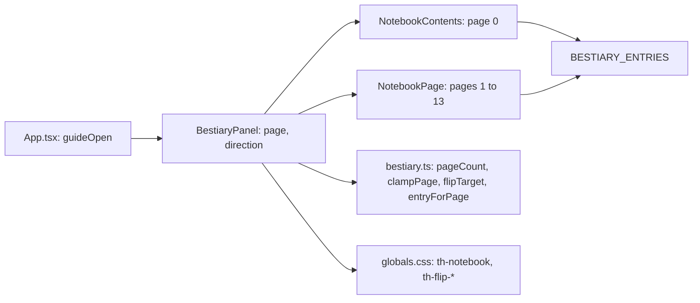

# Design Document

## Overview

Four small parts, all additive except the panel, which the revision rewrites.

1. `src/ui/bestiary.ts`: a pure table, two lookup helpers and (revision) four page helpers. It builds the 13 entries from `MONSTER_PRESENTATION` and `LINK_CREATURES`, so a new monster or creature in those tables reaches the guide without a second edit.
2. `src/components/BestiaryButton.tsx` and `src/components/BestiaryPanel.tsx`: the notebook button and the dialog.
3. (Revision) `NotebookContents.tsx` and `NotebookPage.tsx`: the two page bodies. Notebook styling lives in `src/app/globals.css`.
4. Dictionary keys, one art id and the `App.tsx` wiring.

The guide has no input from the check. `App.tsx` holds one `useState<boolean>` for open/closed. It passes only `locale` and `onClose` (and the focus return ref) to the panel.

Revision 4 summary (tasks 22 to 24): the visible page indicator is removed, each leaf is its own scroll container with its own scrollbar, and the navigation row holds only the previous and next buttons. This supersedes every indicator text ("n / 14", "1-2 / 14") and the single shared page-area scroll below; each is marked in place. See "No indicator, scroll per leaf (revision 4)".

Revision 3 summary (tasks 17 to 21): on wide screens (48rem and up) the notebook shows a two-page spread and every flip turns a pair of pages. Below 48rem it stays one logical page per step. This supersedes the "spread look holds one logical page" and "one page at a time" wording for wide screens, and the earlier rule that content sits on the right page only. See "Two-page spread (revision 3)". Wherever the text below describes one page area with one page wrapper on wide screens, that part is superseded by that section.

Revision 2 summary (tasks 13 to 16): page 0 becomes a sticker board (small art plus short name per entry, no dotted leaders, no visible page numbers), and the panel gets an open-notebook look (spread look on wide screens made by CSS only, still one logical page). No component prop changes, no new file, no new dependency, no new font.

Revision summary: the list view, the detail view, `selectedId` and the back button are gone. The panel is a notebook of 14 pages (contents page plus 13 entry pages), one page at a time, with a CSS flip effect.

## Files

Status column: **done** means built by tasks 1 to 6 and unchanged. **revise** means edited by the notebook follow-up (tasks 7 to 12).

| File | Change | Status |
|---|---|---|
| `src/ui/bestiary.ts` | `BESTIARY_ENTRIES`, `groupEntries`, `findEntry`. Revision adds `pageCount`, `clampPage`, `flipTarget`, `entryForPage`, type `FlipDirection`. | revise |
| `src/ui/bestiary.test.ts` | Unit tests (REQ-BEST-01, 02). Not edited. | done |
| `src/ui/bestiary.property.test.ts` | PBT-131 to PBT-133. Not edited. | done |
| `src/ui/bestiary-pages.test.ts` | New. Unit examples for the page helpers. | revise |
| `src/ui/bestiary-pages.property.test.ts` | New. PBT-135 to PBT-138. | revise |
| `src/ui/index.ts` | Revision adds the page helper exports. | revise |
| `src/ui/i18n/en.ts`, `vi.ts` | Revision removes 2 keys and adds 7 (see Dictionary keys). | revise |
| `src/ui/i18n/voice.ts` | Prefix `bestiary.` already in the tier B rule. No change. | done |
| `src/components/art/notebook.tsx` | Decorative SVG for the button. | done |
| `src/components/art/registry.tsx` | `"notebook"` in `ArtId` and `ART_REGISTRY`. | done |
| `src/components/BestiaryButton.tsx` | The button. Unchanged. | done |
| `src/components/BestiaryPanel.tsx` | Rewritten as the notebook shell: dialog, header, page area, navigation, keys, focus, live region. Keeps `nextFocusIndex`. | revise |
| `src/components/NotebookContents.tsx` | Page 0 body. Revision 2 rewrites it as picture stickers plus short names (REQ-BEST-06.1 to 06.3, 06.10, 06.11). | revise 2 |
| `src/components/NotebookPage.tsx` | New. One entry page body. | revise |
| `src/app/globals.css` | New `.th-notebook*` classes and two keyframes. The project styles bespoke paper and motion in this file (`.th-paper`, `.th-page-in`), and the existing reduced-motion blocks there cover any new animation, so the CSS goes here and not in the component. | revise |
| `src/components/BestiaryPanel.tsx` (revision 2) | Markup only: wrapper elements for the open-notebook look (decorative `aria-hidden` spans for spine, stitching, edges, ribbon). State, props, keys and focus logic do not change. | revise 2 |
| `src/app/globals.css` (revision 2) | Adds `.th-notebook-spread`, `.th-notebook-gutter`, `.th-notebook-stitch`, `.th-notebook-edges`, `.th-sticker*` classes and a wide-screen media query. Existing `.th-notebook*` and flip classes keep their names. Removes `.th-notebook-leader`. | revise 2 |
| `src/ui/i18n/en.ts`, `vi.ts` (revision 2) | Text of `bestiary.toc.intro` changes in both languages. No key added or removed. | revise 2 |
| `src/components/notebook-css.test.ts` (revision 2) | Existing file, **needs user approval to edit**: new assertions for the new classes. | revise 2 |
| `src/components/BestiaryPanel.test.ts` | **Existing file, must be edited**: `GUIDE_FILES` gains the two new component files so the static checks of REQ-BEST-07.3 and 07.4 cover them. PBT-134 and all current assertions stay. Edited with user approval. | revise |
| `src/components/notebook-css.test.ts` | New. Reads `globals.css` as text (like `motion-css.test.ts`). | revise |
| `src/components/App.tsx` | State and render both components. Revision: verify only, no code change expected. | done |

Revision 3 files:

| File | Change | Status |
|---|---|---|
| `src/ui/bestiary.ts` | Adds `LayoutMode`, `spreadCount`, `clampSpread`, `spreadOf`, `pagesOfSpread`, `flipSpread`, `visiblePages`. Existing helpers unchanged. | revise 3 |
| `src/ui/index.ts` | Exports the new helpers and `LayoutMode`. | revise 3 |
| `src/ui/bestiary-spreads.test.ts`, `src/ui/bestiary-spreads.property.test.ts` | New. Examples and PBT-139 to PBT-144. | revise 3 |
| `src/components/use-layout-mode.ts` | New. `useLayoutMode()` hook, `SPREAD_QUERY`, pure `readLayoutMode`. | revise 3 |
| `src/components/BestiaryPanel.tsx` | Mode-aware state, flip, focus, indicator, two leaves. | revise 3 |
| `src/app/globals.css` | Leaf grid, gutter, stitching, edges and ribbon placed for two leaves, high-contrast divider. No new keyframes. | revise 3 |
| `src/components/NotebookContents.tsx`, `NotebookPage.tsx` | No change expected (props stay). | done |
| `src/ui/i18n/en.ts`, `vi.ts` | No change (no key added). | done |
| `src/components/notebook-css.test.ts`, `BestiaryPanel.test.ts` | **Need user approval during execution (already approved for this feature).** See "Existing tests that change". | revise 3 |

Revision 4 files:

| File | Change | Status |
|---|---|---|
| `src/components/BestiaryPanel.tsx` | Removes the indicator and the shared scroll box. Adds one scroll container per leaf. Navigation row with two buttons only. | revise 4 |
| `src/app/globals.css` | Leaf scroll class, scrollbar styling, leaf height rules, high-contrast scrollbar. No new keyframes. | revise 4 |
| `src/ui/i18n/en.ts`, `vi.ts` | Remove `bestiary.page.of`. 15 keys remain. | revise 4 |
| `src/components/notebook-css.test.ts`, `src/components/BestiaryPanel.test.ts` | **Need user approval during execution (already approved for this feature).** | revise 4 |
| `src/ui/bestiary-wording.test.ts` | **Needs user approval during execution (not yet approved).** Key count 16 becomes 15. | revise 4 |
| `src/components/use-layout-mode.ts`, `NotebookContents.tsx`, `NotebookPage.tsx`, `src/ui/bestiary.ts` | No change. | done |

Revision 5 files:

| File | Change | Status |
|---|---|---|
| `src/components/Frame.tsx` | Removes the `footer` prop and strip. Adds the optional `guide` slot (first child) and the narrow-case spacer. | revise 5 |
| `src/components/BestiaryButton.tsx` | Adds the top-left corner wrapper and the compact classes. Props and behavior unchanged. | revise 5 |
| `src/components/App.tsx` | `footer={...}` becomes `guide={...}`. | revise 5 |
| `src/components/Frame.test.ts` | New. Slot, spacer and no-`footer` checks. | revise 5 |
| `BestiaryPanel.test.ts`, `notebook-css.test.ts`, `e2e/hunt-flow.spec.ts` | Expected unedited. See "Existing tests (revision 5)". The e2e file needs approval before any edit (not yet approved). | revise 5 |

No file in `src/core`, `src/analyzers`, `src/pipeline`, `src/server`, `src/app/api` changes. No dependency is added.

## Architecture



Data flows one way: the static table and the pure page helpers feed the panel, and the panel holds only the page index and the flip direction. Nothing reads the check, the network or storage.

## Data Models

```ts
// src/ui/bestiary.ts
import type { MessageKey } from "./i18n/en";
import { LINK_CREATURES, LINK_TONES } from "./link-creatures";
import { MONSTER_PRESENTATION } from "./monsters";

const MONSTER_ORDER = ["bank", "prize", "job-bait", "authority", "generic"] as const;
```

- Monster entry: `id = "monster:" + key`, `nameKey` and `artKey` and `colorToken` from `MONSTER_PRESENTATION[key]`, `descKey = "monster.<key>.short"`, `tipKeys = ["monster.<key>.tip1", ".tip2", ".tip3"]`.
- Link entry: `id = "link:" + creature.id`, `descKey = "link.<id>.desc"`, `tipKeys = ["link.<id>.tip1", ".tip2", ".tip3"]`, `toneLabelKey = LINK_TONES[tone].labelKey`, `toneExplainKey = creature.explanationKey ?? LINK_TONES[tone].explanationKey`.
- Keys built from strings are cast once, inside a helper that a test checks against the dictionary (PBT-131), so a typo fails a test and not a screen.
- `groupEntries(entries)` returns `{ monsters, links }`. `findEntry(id)` is a `find` over the table and never throws.

### Page helpers (revision)

```ts
export type FlipDirection = "next" | "prev";

/** Entries plus the contents page. */
export function pageCount(entries: readonly BestiaryEntry[]): number {
  return entries.length + 1;
}

/** Integer index in [0, max(count - 1, 0)] for any input. NaN and non-finite page become 0, +Infinity the last page. */
export function clampPage(page: number, count: number): number;

/** One step in `direction` from the clamped page; stays at the ends. */
export function flipTarget(page: number, count: number, direction: FlipDirection): number;

/** Page 0 and any page outside 1..entries.length give undefined. Never throws. */
export function entryForPage(entries: readonly BestiaryEntry[], page: number): BestiaryEntry | undefined;
```

- `clampPage`: `max = Number.isFinite(count) ? Math.max(Math.floor(count) - 1, 0) : 0`. If `page` is `NaN` return 0. Otherwise `Math.min(Math.max(Math.trunc(page), 0), max)`. `Math.trunc(Infinity)` is `Infinity`, which the `min` turns into `max`; `-Infinity` becomes 0.
- `flipTarget` is `clampPage(clampPage(page, count) + (direction === "next" ? 1 : -1), count)`.
- `entryForPage` returns `undefined` unless `page` is an integer from 1 to `entries.length`.
- One numbering rule: helpers and state are 0-based, and every number the user sees is the 0-based page plus one. The contents page shows "1 / 14", the Bank page (page index 1) shows "2 / 14", and the Bank sticker on the contents page is announced as "page 2" in its visually hidden text (the number is not visible on the sticker). The same `page + 1` expression feeds the indicator, the announcement and the sticker text. SUPERSEDED in revision 4: there is no visible indicator ("1 / 14", "2 / 14" are no longer shown). The `page + 1` expression feeds only the announcement, the leaf labels and the hidden sticker text ("page 2" for Bank stays).

## Components and Interfaces

### `BestiaryButton`

Unchanged. Props: `locale`, `open`, `onClick`, and a `buttonRef`. Renders a `<button type="button">` with `aria-haspopup="dialog"`, `aria-expanded={open}`, `<Art id="notebook" />` (decorative) and the text `bestiary.open`. Minimum size `min-h-11 min-w-11`. It sits in the `Frame` footer strip. SUPERSEDED in revision 5: it sits in the top-left corner of the `Frame` (see "Button in the top-left corner (revision 5)"). Everything else in this paragraph stays (native button, `aria-haspopup`, `aria-expanded`, decorative picture, visible label, `FOCUS_RING`, same props).

Test note: `art.test.ts` is unedited except one user-approved line, `"notebook",` added to `EXPECTED_IDS` (REQ-BEST-09.2). `art-budget.test.ts` and `registry.test.ts` are unedited.

### `BestiaryPanel` (rewritten as a notebook)

Props unchanged: `locale`, `onClose`, `returnFocusRef`. No verdict, text or files.

State: `page: number` (starts at 0) and `direction: FlipDirection | null` (starts at `null`, meaning no effect). Nothing else. `selectedId` is removed.

Layout, top to bottom, inside one `role="dialog" aria-modal="true" aria-labelledby={titleId}` box (`max-h-[90dvh]`, flex column, overlay and backdrop as before):

1. Header: the title `h2` (`bestiary.title`, `tabIndex -1`, focused on open) and the close button.
(Items 2 and 3 below are SUPERSEDED in revision 4: the page area no longer scrolls or carries the label, and the navigation row no longer has an indicator. See "No indicator, scroll per leaf (revision 4)".)

2. Notebook body, class `th-notebook`: the spine, the page edges and an optional ribbon are decoration (`aria-hidden`). Inside it, the page area `th-notebook-page-area` is `min-h-0 flex-1 overflow-y-auto`, `tabIndex 0`, with `aria-label` from `bestiary.page.label` (same keyboard-scroll rule as the journal). Inside the area, a wrapper keyed by `page` carries the flip class, so a page change remounts it and the effect plays on the new page.
3. Navigation row (outside the scroll area, always reachable): previous button, indicator, next button. It wraps (`flex-wrap`) at 320 px and 200 percent text.
4. A visually hidden `<p role="status" aria-live="polite">` with the announcement.

Page content:

- `page === 0`: `NotebookContents`. Otherwise `entryForPage(BESTIARY_ENTRIES, page)` goes to `NotebookPage`. If it returns `undefined` (cannot happen after clamping), render the contents page.
- Contents page (`NotebookContents`), props `locale`, `onGoTo(page)` (unchanged): heading `h3` `bestiary.toc.heading` (`tabIndex -1`), `bestiary.toc.intro`, then two `<h4 className="th-hand">` group headings (`bestiary.group.monsters`, `bestiary.group.links`). The `th-hand` class already sets `font-family: var(--th-hand)` (Grenze Gotisch, self-hosted), so no font is added. Each heading is followed by an `<ol className="th-sticker-board">` (a wrapping flex list) of `<li>` items. Revision 2:
  - Each `<li>` holds one `<button type="button" className="th-sticker">` with, in order: the decorative art in an `aria-hidden` wrapper (`<Art id={entry.artKey} />` for a monster, `<LinkCreatureArt artKey={entry.artKey} />` inside `LINK_CREATURE_DISC` for a link creature), the visible name `<span>` (`nameKey`), and a visually hidden `<span className="sr-only">` with the kind label and the page text: `bestiary.kind.*` then `bestiary.toc.page` with `{page: page + 1}`. Accessible name example: "Bank Ghost Scam monster page 2".
  - The visible sticker has no page number, no `bestiary.toc.page` text, no dotted leader and no kind label as visible text. Kind is still in words through the group heading and the hidden label (REQ-BEST-02.2, REQ-BEST-06.10).
  - Sticker sizing: `min-h-11 min-w-11` at least, art about `4rem` square (`3rem` at large text), name in `text-base` or the Tailwind scale, `max-w` so 2 to 3 stickers fit per row at 320 px (each about `calc(50% - gap)` to `calc(33% - gap)`), `flex-wrap`, `overflow-wrap: anywhere` on the name, so nothing overflows at 320 px and 200 percent text (REQ-BEST-06.11).
  - Per-sticker tilt is a static rotation of at most 2 degrees chosen by list index (`:nth-child` in CSS, not in JS), so no extra state or random value is needed and server and client render the same.
  - It does not show `bestiary.note`.
- Entry page (`NotebookPage`), props `locale`, `entry`, `isLast`: order is art, name `h3` (`tabIndex -1`), kind label, description, (link only) tone label and explanation, `bestiary.signs.heading` `h4` with the tip list, (link only) `link.plain.note`, and, only when `isLast` is true, `bestiary.note` as the closing line. The panel passes `isLast={page === count - 1}`, so the note shows on page index 13 ("14 / 14") and nowhere else (REQ-BEST-06.9). `isLast` is a boolean, not verdict, text or files data. Art by kind as before: monsters use `<Art id={entry.artKey} />`, link entries use `<LinkCreatureArt artKey={entry.artKey} />` inside the `LINK_CREATURE_DISC` span. Kind is also given by the text label.

Behavior:

- `flip(direction)`: `setDirection(direction); setPage(flipTarget(page, count, direction))`. `goTo(target)`: `const next = clampPage(target, count); setDirection(next >= page ? "next" : "prev"); setPage(next)`.
- Previous button is not rendered at page 0, next button is not rendered at the last page. A same-size empty `<span>` keeps the indicator in place. Both buttons are `min-h-11 min-w-11` with visible text (`bestiary.page.prev`, `bestiary.page.next`) and `FOCUS_RING`.
- Indicator: `t(locale, "bestiary.page.of", { current: page + 1, total: count })`, for example "3 / 14". SUPERSEDED in revision 4: no indicator is rendered and `bestiary.page.of` is removed.
- Keys on the dialog `onKeyDown`: Escape closes (ignored when `nativeEvent.isComposing`). Tab trap as before through `nextFocusIndex`. ArrowRight and ArrowLeft flip (ignored when `isComposing`, or `ctrlKey`, `altKey` or `metaKey` is held; `preventDefault` only when a flip happens).
- Focus: on first open, focus the title (as before). After any page change (not on first render), an effect focuses the page heading through a ref (`tabIndex -1`). The announcement text is set in the same effect: `t(locale, "bestiary.page.label", { current, total, name })`, where `name` is `bestiary.toc.heading` for page 0 and the entry's name otherwise. It is empty at first open, so nothing is announced then.
- A focused heading scrolls the page area to the top of the new page, because the wrapper is new.
- On unmount: `returnFocusRef.current?.focus()`. State is dropped with the component, so the next open starts at page 0 (REQ-BEST-05.9).
- The old "back to list" button, `selectedId` and `lastSelectedRef` are deleted.

### Flip effect and look (CSS, in `globals.css`)

```css
.th-notebook { perspective: 70rem; /* paper surface, spine, edges: see below */ }
.th-flip-next { transform-origin: 0% 50%; animation: th-flip-next 1s ease-out both; }
.th-flip-prev { transform-origin: 100% 50%; animation: th-flip-prev 1s ease-out both; }
@keyframes th-flip-next { from { opacity: 0; transform: rotateY(-70deg); } }
@keyframes th-flip-prev { from { opacity: 0; transform: rotateY(70deg); } }
```

- Pure CSS. Only `transform` and `opacity`. No dependency.
- The flip class goes on the inner page wrapper, not on the scroll area, so the scroll box never rotates and nothing is clipped at rest. At rest the base style applies (`both` and start-only keyframes), which is the readable final state.
- Forward flips pivot on the spine (left edge) and backward flips on the right edge, so the direction is visible. `direction === null` means no class and no effect on first open.
- Duration is 1 second because the existing `motion-css.test.ts` requires every `th-*` animation to last at least 1 second. A shorter flip would need a user-approved edit to that test. The user confirmed the 1 second duration.
- Reduced motion: the existing `@media (prefers-reduced-motion: reduce)` block and the `:root[data-reduce-motion="true"]` block already set `animation: none !important` on every element, so the page changes instantly. No new reduced-motion CSS is needed. `notebook-css.test.ts` checks that the new animations are plain `animation:` declarations that these blocks override (no `!important` and no inline style on them).
- Look: `.th-notebook-page-area` has `background-color: var(--th-paper)`, ink text through `--th-text: var(--th-ink)` and `--th-muted: var(--th-ink-faded)` (as `.th-paper` sets them), a few ruled-line gradients like `.th-ruled`, a spine strip on the left made of a dark-to-paper linear gradient plus stitch marks (dashed gradient), page edges as stacked thin box-shadows on the right and bottom (`0.125rem` steps), and a ribbon as a narrow `::after` strip in `var(--th-blood)` that hangs from the top edge. All sizes in `rem`. No text in any pseudo-element (`content: ""`).
- It does not reuse `.th-paper`: that class has a clip-path edge and hides borders, which could clip text at 200 percent. A new class avoids both.
- High contrast: `[data-high-contrast="true"] .th-notebook*` removes gradients, shadows and the ribbon and keeps a plain surface, like the `.th-paper` rule.

#### Open-notebook look (revision 2, REQ-BEST-11.6 to 11.12)

Markup (all decoration is `aria-hidden` and empty, `content: ""` for pseudo-elements):

```tsx
<div className="th-notebook th-notebook-spread">          {/* table + open book */}
  <span className="th-notebook-edges" aria-hidden="true" />   {/* stacked page edges, both sides */}
  <span className="th-notebook-gutter" aria-hidden="true" /> {/* centre spine shadow, wide only */}
  <span className="th-notebook-stitch" aria-hidden="true" /> {/* stitched binding */}
  <span className="th-notebook-ribbon" aria-hidden="true" />
  <div className="th-notebook-page-area">...one logical page...</div>
</div>
```

- Table: the panel backdrop already darkens the page; the `.th-notebook` box gets a wood-grain gradient border band (`repeating-linear-gradient` of `--th-bg` and a slightly lighter existing token) around the open book, so the book "lies on the table".
- Paper texture: layered `radial-gradient` speckles and `repeating-linear-gradient` ruled lines over `--th-paper`, kept faint so text contrast stays AA. No image file.
- Two-page spread look (min-width about `48rem`, `@media (min-width: 48rem)`): the page area stays one column. The spread look comes from a centre `linear-gradient` gutter shadow (`.th-notebook-gutter`), a mirrored half-width "left page" panel drawn as a background gradient behind the area (paper tone with ruled lines, no text), and page edges on both sides. The left half has no content and no DOM children of its own.
- Page curl and edges: stacked thin `box-shadow` steps (`0.125rem`) on the right and bottom, plus a bottom-right corner curl made of a `linear-gradient(135deg, transparent 50%, ...)` square of `1.5rem`.
- Stitched binding: a vertical dashed `repeating-linear-gradient` strip beside the gutter (narrow screens: along the left edge).
- Ribbon: the existing `.th-notebook-ribbon` strip, kept; it hangs from the top and is at most `0.75rem` wide.
- Narrow screens (below `48rem`): no gutter, no left half, edges reduced to the right and bottom, stitching on the left edge. The page area keeps its full width.
- Stickers (`.th-sticker`): paper-scrap tone from a lighter paper gradient, thin torn-look border from `box-shadow` (no `clip-path`), a "tape" strip as a `::before` on the top edge, a soft shadow, and a static `transform: rotate()` of -2 to 2 degrees by `:nth-child` (rest state, not animated). `:focus-visible` uses the shared focus ring and removes the tilt so the outline is not rotated. Hover only lifts the shadow, no motion.
- High contrast: `[data-high-contrast="true"]` rules remove the table band, texture, spread left half, gutter, stitching, edges, curl, ribbon, sticker tape, shadow and tilt, and give stickers a plain border.
- Reduced motion: unchanged. No new animation is added, and the sticker tilt and shadows are static.
- Colors are existing tokens only (`--th-paper`, `--th-ink`, `--th-ink-faded`, `--th-blood`), so no new token and no new contrast pair is needed. The ribbon is decoration; the page number and the buttons carry the meaning as text.
- Small screens: the page area keeps `overflow-y-auto` and `min-h-0` (SUPERSEDED in revision 4: each leaf scrolls, the page area does not), the dialog box scrolls nothing itself, and the navigation row sits below the area, so the buttons stay on screen at 320 px and 200 percent text. At 200 percent text the art is `h-24 w-24` at most.

### `App.tsx`

```tsx
const [guideOpen, setGuideOpen] = useState(false);
const guideButtonRef = useRef<HTMLButtonElement>(null);
// ...
<BestiaryButton locale={locale} open={guideOpen} onClick={() => setGuideOpen(true)} buttonRef={guideButtonRef} />
{guideOpen ? <BestiaryPanel locale={locale} onClose={() => setGuideOpen(false)} returnFocusRef={guideButtonRef} /> : null}
```

`guideOpen` is independent of `PageState` and of the flow reducer. The button renders in every state, including `working`. No change is expected in the revision. SUPERSEDED in revision 5: `App.tsx` changes one line, `footer={<BestiaryButton ... />}` becomes `guide={<BestiaryButton ... />}` on `Frame`. State, ref and panel stay as shown.

## Button in the top-left corner (revision 5)

Requested by the user (REQ-BEST-14). Supersedes the "Frame footer strip" wording in this document (marked in place), in `requirements.md` (REQ-BEST-04.5) and in task 10.

### What the code does today (read before this revision)

- `Frame.tsx`: `h-dvh flex-col overflow-hidden`; children are `main` (flex-1), then an optional `footer` strip (`relative z-20 flex shrink-0 justify-start px-3 py-2`), then `stage`, then `controls`.
- `TopControls.tsx`: its own wrapper `pointer-events-none absolute right-3 top-3 z-20`, buttons `pointer-events-auto`, three `.th-chip` of `2.75rem` with `gap-2`. Width: 3 x 2.75 + 2 x 0.5 = `9.25rem`, so `10rem` from the right edge with the inset.
- `App.tsx`: home and bag content use `pt-[3.75rem]` so nothing sits under the controls; the revealed step uses `md:pt-[3.75rem]`.
- `BestiaryButton.tsx`: `pointer-events-auto flex min-h-11 min-w-11 items-center gap-2 ... px-2 py-1 text-base`, a `h-9 w-9` picture and the label.

### Placement

- The button follows the `TopControls` pattern exactly, mirrored: `BestiaryButton` renders its own wrapper `<div className="pointer-events-none absolute left-3 top-3 z-20 max-w-[calc(100%-11.25rem)]">` and the button keeps `pointer-events-auto`. Same inset (`0.75rem`), same layer (`z-20`), so the two corners share the safe area and the `3.75rem` top space already kept by home and bag.
- `Frame` gets one optional slot `guide?: ReactNode` rendered as the first child (before `main`), so Tab reaches the top-left button first, in reading order. The wrapper is absolute, so its place in the document does not change the layout.
- Always rendered, in every step and page state. The button lives in `Frame`, outside every scrolling region, so it never scrolls away.
- Width budget while the viewport is `18rem` or wider: `100% - 11.25rem` (10rem for `TopControls` + 0.5rem gap + 0.75rem inset). At 320 CSS pixels and 100 percent text (20rem) the budget is `8.75rem`.

### Compact form (when the budget is smaller than the full button)

- Full form (about `9.75rem` in English): picture `2.25rem`, label on one line, `text-base`. It fits from about `21rem` up.
- Compact form (shown when the budget is smaller, using the wrapper cap and `min-w-0` so the label wraps): picture `h-7 w-7` (`1.75rem`), label allowed to wrap to two lines with `leading-tight` and `[overflow-wrap:anywhere]`, padding `px-2 py-0.5`. The box height stays at most `3rem` so it ends inside the `3.75rem` top space. The label `bestiary.open` is always visible and never clipped. The picture shrinks first; the text label never disappears. `min-h-11 min-w-11` stays. Exact class choice is settled and verified in the browser check (task 26); the limits above are the contract.
- The Vietnamese label "Sổ tay" is shorter than "Field guide", so it fits more easily.

### Very narrow case (below `18rem`, includes 320 px at 200 percent text)

- At 200 percent text one `rem` is 32 CSS pixels, so a 320 px viewport is `10rem` wide and `TopControls` (`10rem`) fills the whole row. There is no room beside it.
- Rule: below `18rem` (Tailwind `min-[18rem]` as the switch; the media query is in `em`, so it follows the text size) the wrapper moves to `top-[3.75rem]`, a second row directly under `TopControls`, and `max-w` is `calc(100% - 1.5rem)`. `Frame` renders an empty `aria-hidden` spacer `h-[6.5rem] shrink-0 min-[18rem]:hidden` before `main` when `guide` is set, so the button sits inside the spacer (rows `3.75rem` to `6.5rem`) and `main` starts below it. The home and bag steps still keep their own `3.75rem` top space, so some vertical room is lost only in this narrow case. This is the accepted cost. If the browser check shows too little room, the fallback is to reduce the spacer or the reserve in task 26 and report it.
- The button never overlaps `TopControls` in either case, and never overlaps the title or the input because the content starts below the spacer.

### Frame footer: removed

- The optional `footer` prop and its strip (`relative z-20 flex shrink-0 justify-start px-3 py-2`) are removed from `Frame.tsx`: after the move nothing uses them, and dead code is not kept. The comment on `controls` stays; the new slot gets its own comment.
- No test reads or sets `footer` on `Frame` (checked). `focus.test.ts` renders `Frame` with `step` and `children` only. `JournalSheet.test.ts` mentions `<footer` for the journal footer, a different element.

### Behavior that stays

- Native `<button type="button">`, `aria-haspopup="dialog"`, `aria-expanded={open}`, `FOCUS_RING`, decorative `aria-hidden` picture, visible label `bestiary.open`.
- Focus returns to this button on close (`returnFocusRef={guideButtonRef}`, unchanged). The panel overlay (`aria-modal`, backdrop, focus trap) covers it while open; the button is not hidden or inert, as before.
- Props of `BestiaryButton` are unchanged (the `BestiaryPanel.test.ts` props check keeps passing). `guideOpen` stays independent of `PageState`.
- High contrast: the button already uses `--th-surface`, `--th-border` and `--th-text` tokens; no new token.

### Existing tests (revision 5)

| Test | Change | Approval |
|---|---|---|
| `BestiaryPanel.test.ts` | Expected unedited. It scans `BestiaryButton.tsx` for forbidden APIs and checks the props interface; the wrapper adds neither. | already approved if an edit turns out to be needed |
| `notebook-css.test.ts` | Expected unedited (no new rule in `globals.css`). | already approved if a rule is added |
| `focus.test.ts`, `TopControls.test.ts`, `components.boundaries.test.ts`, `high-contrast-css.test.ts`, `motion-css.test.ts` | Not edited, must pass. | none |
| `e2e/hunt-flow.spec.ts` | Expected unedited (no reference to the button or the footer). Stop and ask before editing it if a locator breaks. | **NOT yet approved** |
| `src/components/Frame.test.ts` | New file: renders `Frame` with a `guide` and checks the slot and the spacer, renders without `guide` and checks neither exists, and reads `Frame.tsx` source to check there is no `footer`. | none (new file) |

### Testing note

Property-based testing does not apply: the change is markup and layout classes with no pure logic. Coverage is the new example test file, the unchanged suites above, `tsc --noEmit`, and the browser check at 1280 px, 320 px and 200 percent text in task 26 with screenshots.

## Dictionary keys

Final set: **16** `bestiary.*` keys in each table. SUPERSEDED in revision 4: the final set is **15** keys, because `bestiary.page.of` is removed (see "Revision 4 key changes" after the table; the table rows below stay as history). Interpolation uses `{name}` placeholders through `t(locale, key, params)`, as `result.meter.label` does.

| Key | Status | English | Vietnamese (draft) |
|---|---|---|---|
| `bestiary.open` | kept | Field guide | Sổ tay |
| `bestiary.title` | kept | Field guide | Sổ tay quái vật |
| `bestiary.close` | kept | Close | Đóng |
| `bestiary.group.monsters` | kept (heading on the contents page) | Scam monsters | Quái vật lừa đảo |
| `bestiary.group.links` | kept (heading on the contents page) | Link creatures | Sinh vật đường dẫn |
| `bestiary.kind.monster` | kept | Scam monster | Quái vật lừa đảo |
| `bestiary.kind.link` | kept | Link creature | Sinh vật đường dẫn |
| `bestiary.signs.heading` | kept | Warning signs | Dấu hiệu cảnh báo |
| `bestiary.note` | kept (last page only) | These are common patterns to help you spot a scam. A message can match none of them and still be a scam, so keep checking. | Đây là các mẫu lừa đảo thường gặp để bạn dễ nhận ra. Một tin nhắn có thể không giống mục nào mà vẫn là lừa đảo, nên hãy luôn kiểm tra kỹ. |
| `bestiary.toc.heading` | new | Contents | Mục lục |
| `bestiary.toc.intro` | new, text changed in revision 2 | Turn the pages to read about each one. Tap a picture to jump to its page. | Lật từng trang để đọc về từng mục. Chạm vào một hình để nhảy tới trang đó. |
| `bestiary.toc.page` | new, kept in revision 2 as visually hidden text only (not shown on screen) | page {page} | trang {page} |
| `bestiary.page.prev` | new | Previous page | Trang trước |
| `bestiary.page.next` | new | Next page | Trang sau |
| `bestiary.page.of` | new; **removed in revision 4** (it only fed the visible indicator) | {current} / {total} | {current} / {total} |
| `bestiary.page.label` | new | Page {current} of {total}: {name} | Trang {current} trên {total}: {name} |

**Removed from both tables:**

- `bestiary.intro` ("Tap one to see its warning signs") described tiles. It is replaced by `bestiary.toc.intro`.
- `bestiary.back` has no use, since the back button is gone.

**Kept although the layout changed:** `bestiary.group.monsters` and `bestiary.group.links` stay as headings inside the contents page. `bestiary.signs.heading` and both kind keys are still used on entry pages and contents lines.

**Revision 2 key changes (tasks 13 to 16):**

- Added: none. Removed: none. The set stays at 16, so `bestiary-wording.test.ts` (count of 16) needs no edit.
- Text changed: `bestiary.toc.intro` in `en.ts` and `vi.ts` (see table). Placeholders: none, so parity holds.
- Kept, now visually hidden only: `bestiary.toc.page` (keeps `{page}` in both languages). It is the page part of each sticker's accessible name.
- Kept and reused as visually hidden text: `bestiary.kind.monster` and `bestiary.kind.link` (also still used on entry pages).
- Kept: `bestiary.toc.heading`, `bestiary.group.monsters`, `bestiary.group.links` (now Hand headings), and every other key.
- If the user later prefers a separate sticker label key (for example `bestiary.sticker.label` with `{name}`, `{kind}`, `{page}`), that is a +1 key and needs the user's approval and an edit of the count in `bestiary-wording.test.ts`. Not planned.
- No new string contains "safe" or "an toàn".

**Revision 4 key changes (tasks 22 to 24):**

- Removed from both tables: `bestiary.page.of`. Nothing else is added or removed.
- Kept, because still used: `bestiary.page.label` (live announcement and the accessible name of each leaf scroll area), `bestiary.page.prev`, `bestiary.page.next`, `bestiary.toc.page` (hidden sticker text), and all other keys.
- Final set (15), identical in `en` and `vi`: `bestiary.open`, `bestiary.title`, `bestiary.close`, `bestiary.group.monsters`, `bestiary.group.links`, `bestiary.kind.monster`, `bestiary.kind.link`, `bestiary.signs.heading`, `bestiary.note`, `bestiary.toc.heading`, `bestiary.toc.intro`, `bestiary.toc.page`, `bestiary.page.prev`, `bestiary.page.next`, `bestiary.page.label`. English and Vietnamese key sets stay equal (parity), and no text of a kept key changes.
- `bestiary-wording.test.ts` asserts a count of 16. It must change to 15. **This edit needs the user's approval during execution and is not yet approved.** The dictionary parity test and the voice tests iterate every key and need no edit.
- Alternative if the user wants zero test edits: keep `bestiary.page.of` and use it as the visually hidden text of the live region. This was not chosen, because it keeps a key whose only purpose was a visible indicator, and the live region already works with `bestiary.page.label`.

Net change against the state after tasks 1 to 6: 2 keys removed, 7 keys added, 9 kept. Entry text reuses `monster.*` and `link.*` keys that already exist in both tables. The Vietnamese column is a draft for review. No string says "safe" or "an toàn" as a verdict.

`voice.ts`: the prefix `bestiary.` is already in the tier B (meaning first) rule, so the seven new keys are tier B with no edit. Every new English string has at most one horror word (none of the new keys has one) and stays below the length limits. The dictionary parity test and the voice property tests iterate every key, so they cover the new set and stop seeing the two removed keys, with no edit.

## Two-page spread (revision 3)

### Spread layout

14 logical pages (0 = contents, 1 to 13 = entries) make 7 spreads. Spread s holds pages 2s (left leaf) and 2s + 1 (right leaf).

| Spread | Left | Right |
|---|---|---|
| 0 | 0 Contents | 1 Bank |
| 1 | 2 Prize | 3 Job-bait |
| 2 | 4 Authority | 5 Generic |
| 3 to 6 | 6, 8, 10, 12 (link creatures 1, 3, 5, 7) | 7, 9, 11, 13 (link creatures 2, 4, 6, 8) |

Parity: the count is `entries + 1 = 14`, even, so every spread is full and the last spread is pages 12 and 13. Page 13 is on the right leaf of spread 6 and is the only page with `bestiary.note`. For an odd count n, `spreadCount = (n + 1) / 2`, the last spread has page n - 1 on the left leaf and a blank right leaf (decorative paper, `aria-hidden`, no heading), and the note sits on the left leaf. `NotebookPage` still gets `isLast={pageIndex === count - 1}` per leaf, so the rule is the same wherever the page sits.

### Pure helpers (`src/ui/bestiary.ts`)

```ts
export type LayoutMode = "single" | "spread";
// n = Number.isFinite(count) ? Math.max(Math.floor(count), 1) : 1   (same effective count as clampPage)
export function spreadCount(count: number): number;               // Math.ceil(n / 2)
export function clampSpread(spread: number, count: number): number; // NaN -> 0, else trunc, clamped to [0, spreadCount - 1]
export function spreadOf(page: number, count: number): number;    // Math.floor(clampPage(page, count) / 2)
export function pagesOfSpread(spread: number, count: number): { readonly left: number; readonly right: number | undefined };
// left = 2 * clampSpread(spread); right = left + 1 when left + 1 <= n - 1, else undefined
export function flipSpread(spread: number, count: number, direction: FlipDirection): number;
// clampSpread(clampSpread(spread) +/- 1)
export function visiblePages(page: number, count: number, mode: LayoutMode): { readonly left: number; readonly right: number | undefined };
// single: { left: clampPage(page, count), right: undefined }; spread: pagesOfSpread(spreadOf(page, count), count)
```

All are total and pure. Reuse `clampPage` and `FlipDirection`.

### Layout mode hook (`src/components/use-layout-mode.ts`)

```ts
export const SPREAD_QUERY = "(min-width: 48rem)";
export function readLayoutMode(list: { readonly matches: boolean } | undefined): LayoutMode; // pure: matches ? "spread" : "single"
export function useLayoutMode(): LayoutMode;
```

- Built on `useSyncExternalStore`. `subscribe(cb)` gets `window.matchMedia(SPREAD_QUERY)` (only when `typeof window !== "undefined"` and `matchMedia` is a function), adds a `change` listener and returns a function that removes it. `getSnapshot` returns `readLayoutMode(list)`. `getServerSnapshot` returns `"single"`. A missing `matchMedia` gives `"single"` and no listener.
- No `localStorage`, cookie, network or logging. The mode is never stored, so each open measures again.
- The query uses `rem`, so it matches the 48rem breakpoint of the CSS. A browser text size set to 200 percent makes 48rem wider in CSS pixels, so a laptop window falls back to single mode by itself.
- The panel mounts only after a click, so the first client render already reads the real mode. The server default matters for any future server render and keeps the hook safe.
- Tests run in node: `readLayoutMode` is a pure example test, and a fake `window.matchMedia` object exercises subscribe and unsubscribe.

### Panel state and logic

State stays `page` (focused logical page, 0-based) and `direction`. The mode is read from the hook and is not state.

| Action | Single mode | Spread mode |
|---|---|---|
| Flip next / prev (button or ArrowRight / ArrowLeft) | `page = flipTarget(page, count, dir)` | `page = pagesOfSpread(flipSpread(spreadOf(page), count, dir), count).left` |
| Sticker jump to `target` | `page = clampPage(target)` | `page = clampPage(target)` (the spread of that page shows) |
| Direction of a jump | `target >= page ? "next" : "prev"` | `spreadOf(target) >= spreadOf(page) ? "next" : "prev"` |
| Previous button absent | `page === 0` | `spreadOf(page) === 0` |
| Next button absent | `page === count - 1` | `spreadOf(page) === spreadCount - 1` |
| Resize | no state change | no state change |

- Resize rule: the panel keeps `page`. Spread to single shows `page`, which is the left page of the last flipped spread (flips always set the left page) or the page of the last pressed sticker. Single to spread shows `spreadOf(page)`. Example: the user flips to spread 2 (pages 4 and 5), narrows the window and sees page 4. The user pressed the Generic sticker (page 5) in spread mode, narrows and sees page 5.
- A flip uses the visible spread, not only `page`, so flips are consistent after a jump: after a jump to page 5 in spread mode, next goes to spread 3 and sets `page = 6`.
- Visible pages: `const { left, right } = visiblePages(page, count, mode)`. The panel renders one `leaf` per defined page.
- Focus and announcement: a navigation counter (`navTick`, a number in state, bumped by `flip` and `goTo` only, not by resize) drives one effect. The effect focuses `leftHeadingRef` (the left or only leaf heading) and sets the announcement. A mode change alone does not bump it, so resizing never moves focus, announces or plays an effect. On first open `navTick` is 0, so nothing happens. Each leaf heading has `tabIndex -1`. Only the left heading needs a ref. If `goTo` keeps the same `page` and spread, the counter still bumps, so focus moves to the heading again.
- Indicator (SUPERSEDED in revision 4: no visible indicator; `range(left, right)` is kept only as the `current` text of the announcement): `range(left, right)` is `String(left + 1)` when `right` is undefined or the mode is single, else `` `${left + 1}-${right + 1}` ``. The text is `t(locale, "bestiary.page.of", { current: range, total: count })`: "1-2 / 14" on spread 0, "13-14 / 14" on the last spread, "3 / 14" in single mode. `Params` already accepts `string | number`, so no key is added. Decision: the range with logical page numbers was chosen over "1 / 7" because it matches the sticker page numbers ("page 2" for Bank) and the single mode count, and shows both pages that are on screen.
- Announcement and scroll area label (revision 4: the announcement part stays; the single scroll area label is SUPERSEDED by one label per leaf): `t(locale, "bestiary.page.label", { current: range, total: count, name })`, where `name` is the two page names joined by ", " (for example "Contents, Bank Ghost"). A screen reader hears "Page 1-2 of 14: Contents, Bank Ghost". The text "1-2" may be read as "one to two" or "one minus two"; the sentence stays understandable either way. If the Review finds it unclear, the fallback key `bestiary.page.range` (REQ-BEST-12.9) is the only allowed dictionary change and needs the user's approval, a count of 17 in `bestiary-wording.test.ts`, en and vi text equal to "{from}-{to} / {total}", tier B, and no "safe". No key is planned.
- `ArrowLeft` and `ArrowRight` use the same handler as the buttons, so they flip a spread in spread mode. Escape, Tab trap, IME rule and modifier rule are unchanged.

### Markup and CSS

```tsx
<div className="th-notebook th-notebook-spread" data-layout={mode}>
  <span className="th-notebook-edges" aria-hidden="true" />
  <span className="th-notebook-gutter" aria-hidden="true" />
  <span className="th-notebook-stitch" aria-hidden="true" />
  <span className="th-notebook-ribbon" aria-hidden="true" />
  <div className="th-notebook-page-area ..." tabIndex={0} aria-label={...}>   {/* one scroll box for both leaves */}
    <div className="th-notebook-leaves">                                     {/* 1 column, or 2 columns in spread mode */}
      <div key={left} className={`th-notebook-leaf th-notebook-leaf-left ${leftFlip}`}>...left page...</div>
      {right !== undefined
        ? <div key={right} className={`th-notebook-leaf th-notebook-leaf-right ${rightFlip}`}>...right page...</div>
        : mode === "spread" ? <div className="th-notebook-leaf th-notebook-leaf-right" aria-hidden="true" /> : null}
    </div>
  </div>
</div>
```

- One scroll area holds both leaves, so keyboard scrolling, the dictionary label and the focus trap stay as before and the two pages scroll together. The navigation row stays outside it. SUPERSEDED in revision 4: each leaf has its own scroll container (the markup block above shows the old shape).
- `.th-notebook-leaves` is `display: grid` with one column. Under `[data-layout="spread"]` it has two equal columns (`grid-template-columns: repeat(2, minmax(0, 1fr))`) with a column gap that leaves room for the gutter. `minmax(0, 1fr)` and `overflow-wrap: anywhere` stop long names from widening a leaf. The two leaves align to the top (`align-items: start`). The decorative gutter, stitching, edges and ribbon are `aria-hidden` spans placed by CSS: the gutter and stitching sit at the horizontal centre in spread mode (`@media (min-width: 48rem)`, same breakpoint as the hook) and on the left edge below 48rem; edges sit on the outer left and right in spread mode; the ribbon hangs from the top of the gutter. Leaves have no own scroll box, no `clip-path`, no `overflow: hidden` that could cut text.
- Content on both leaves: a leaf holds either `NotebookContents` (page 0, on the left of spread 0) or `NotebookPage` for `entryForPage`. If `entryForPage` is undefined for a page other than 0, that leaf shows the contents page content as before (cannot happen after clamping).
- The `th-notebook-spread` class stays the wrapper name, but its comment "holds one logical page" is replaced by "holds one or two leaves". The mirrored empty left half drawn as a background gradient is removed from the design: the real left leaf replaces it.
- Flip effect: the leaf wrappers are keyed by their logical page index, so a leaf that gets a new page remounts. In spread mode a forward flip puts `th-flip-next` (pivot on the spine, the left edge of the right leaf) on the right leaf only and shows the new left leaf with no effect. A backward flip puts `th-flip-prev` (pivot on the right edge of the left leaf, the spine) on the left leaf only. In single mode the single leaf gets the class for the direction as before. On open, `direction` is `null`, so no class. The two keyframes already change only `transform` and `opacity`, last 1 second and start-only. No new keyframe, no `clip-path`; reduced motion is the existing global override, so the page changes instantly. After the page remount the old leaf is gone at once, so the flip is "the new page turning in". The right leaf pivot on its left edge means it opens away from the spine on a forward flip and the left leaf swings in from the spine on a backward flip, which reads as turning in the correct direction.
- High contrast: `[data-high-contrast="true"]` rules remove gutter, stitching, edges and ribbon as before, and `.th-notebook-leaf-right` gets a plain `border-left` (relative units) as a visible divider. Single mode and the narrow layout are unchanged.
- 320 px and 200 percent text: below 48rem there is one leaf in one column. With 200 percent text the same query keeps the panel in single mode on laptop widths. The navigation row wraps as before. At 48rem and wider, each leaf is about half the dialog width, so the stickers wrap to fewer per row and long names wrap; nothing is clipped.
- The dialog box widens on wide screens so the leaves are readable: the dialog uses `max-w-5xl` at 48rem and above (about 64rem), and keeps its current width below. This is a class edit in `BestiaryPanel.tsx` only.

### Existing tests that change (all need user approval during execution; the user already approved editing both files in this feature)

| Test | Change |
|---|---|
| `src/components/notebook-css.test.ts` | Add `th-notebook-leaves`, `th-notebook-leaf`, `th-notebook-leaf-left`, `th-notebook-leaf-right` to the class-defined list; high-contrast override checks for the leaf divider and gutter in spread mode; the "no image, no clip-path, no px font size, no new keyframes" section scan keeps covering the new rules; keep every other assertion. Check that the current assertions about a single column page area do not conflict (adjust only if they do). |
| `src/components/BestiaryPanel.test.ts` | Append `use-layout-mode.ts` to `GUIDE_FILES` (append, so the `GUIDE_FILES[3]` index used by the note placement check does not move); add checks that the hook uses `matchMedia`, has no storage, network or logging, and defaults to `"single"`; keep the `isLast` check on `NotebookPage.tsx` as is; the props check (no `verdict`, `text`, `files`) also covers the panel's new code. |
| Any test asserting "n / 14" or page counts (revision 4: still none known; task 22 searches again) | A search of `src` and `e2e` found no test that asserts the "n / 14" text or the `bestiary.page.of` output; only `BestiaryPanel.test.ts` and `notebook-css.test.ts` read the guide sources. If task 21 finds one, it needs user approval before an edit. |
| Not edited, must pass | `bestiary.test.ts`, `bestiary.property.test.ts`, `bestiary-pages.test.ts`, `bestiary-pages.property.test.ts`, `bestiary-wording.test.ts` (16 keys), dictionary parity, voice tests, `motion-css.test.ts`, `high-contrast-css.test.ts`, `components.boundaries.test.ts`, art tests. |

## No indicator, scroll per leaf (revision 4)

### Indicator and live region

- The `<p>` with `bestiary.page.of` is deleted from the navigation row. Nothing replaces it visually.
- Kept for assistive technology: the visually hidden `<p role="status" aria-live="polite">` with `bestiary.page.label` (current = "{from}-{to}" in spread mode, one number in single mode, name = page names joined by ", "). It stays silent on first open and on a layout-mode change alone (REQ-BEST-12.5).
- New in each leaf: the scroll container has `aria-label = t(locale, "bestiary.page.label", { current: pageIndex + 1, total: count, name: thatPageName })`, for example "Page 2 of 14: Bank Ghost". The old single label on the page area is removed.
- Keys: `bestiary.page.label` stays used (announcement and leaf labels). `bestiary.page.of` becomes unused and is removed (final 15-key set in "Dictionary keys").

### Markup

```tsx
<div className="th-notebook th-notebook-spread" data-layout={mode}>
  {/* decoration spans unchanged: edges, gutter, stitch, ribbon (aria-hidden) */}
  <div className="th-notebook-page-area">                      {/* frame only: no overflow, no tabIndex, no label */}
    <div className="th-notebook-leaves">                       {/* grid, bounded height, 1 or 2 columns */}
      <div key={left} className={`th-notebook-leaf th-notebook-leaf-left ${leftFlip}`}>   {/* flip wrapper, does not scroll */}
        <div className="th-notebook-leaf-scroll" role="region" tabIndex={0} aria-label={leftLabel}>
          ...left page content (heading tabIndex -1)...
        </div>
      </div>
      {/* right leaf: same shape with th-notebook-leaf-right and rightLabel; blank right leaf of an odd count has no scroll div, no role, no tabIndex, aria-hidden */}
    </div>
  </div>
  <div className="th-notebook-nav flex flex-wrap items-center justify-between gap-2"> {/* prev and next only */} </div>
</div>
```

- The leaf wrapper is keyed by its page index, so a new page remounts the wrapper and its scroll box, which starts at scrollTop 0. No effect is needed to reset the scroll position.
- The flip class stays on the wrapper (`th-notebook-leaf`), never on the scroll box (REQ-BEST-13.9).

### Scroll container

- Height chain, so the leaf is bounded by the dialog: dialog `max-h-[90dvh]` flex column; `th-notebook` and `th-notebook-page-area` are `min-h-0 flex-1` flex items; `.th-notebook-leaves` has `height: 100%`, `display: grid`, `grid-template-rows: minmax(0, 1fr)`; `.th-notebook-leaf` has `min-height: 0` and `height: 100%`; `.th-notebook-leaf-scroll` has `height: 100%`, `min-height: 0`, `overflow-y: auto`, `overflow-x: hidden`, `overscroll-behavior: contain`, `overflow-wrap: anywhere`. Without `minmax(0, 1fr)` and `min-height: 0` a grid or flex child grows to its content and never scrolls.
- Spread mode: two columns, each leaf scrolls alone. Single mode: one column, one leaf. Padding of the page area moves to the scroll box (relative units), so the scrollbar sits at the paper edge.
- Pattern chosen: **always** `tabIndex 0` + `role="region"` + `aria-label`, not only when overflowing. Reasons: it needs no JavaScript measurement (no `ResizeObserver`, nothing to test in the node environment, no hydration difference); the Tab order stays stable when text grows to 200 percent; it matches the existing journal rule ("same keyboard-scroll rule as the journal"); and a named region is the standard pattern for a keyboard-scrollable box (WCAG 2.1.1). The cost is one extra tab stop per leaf (two in spread mode) when a leaf does not overflow. Alternative rejected: toggling `tabIndex` by overflow state, which is more code and flickers.
- Focus trap: `nextFocusIndex` works on the list of focusable elements. The query used to build that list must include `[tabindex="0"]` elements; task 23 checks that the two scroll areas are in the trap and that Tab order is close, left scroll area, right scroll area, previous, next (within each leaf, links or stickers come before the next leaf).
- Focus ring: `.th-notebook-leaf-scroll:focus-visible` uses the shared ring colors with a negative `outline-offset` so the ring is not clipped by the leaf or the dialog.

### Scrollbar styling (theme tokens, relative units)

```css
.th-notebook-leaf-scroll {
  scrollbar-width: thin;
  scrollbar-color: var(--th-ink-faded) var(--th-paper);
}
.th-notebook-leaf-scroll::-webkit-scrollbar { width: 0.875rem; }
.th-notebook-leaf-scroll::-webkit-scrollbar-track { background: var(--th-paper); }
.th-notebook-leaf-scroll::-webkit-scrollbar-thumb {
  background: var(--th-ink-faded);
  border: 0.1875rem solid var(--th-paper);
  border-radius: 0.5rem;
}
```

- Browsers that support `scrollbar-color` ignore the `::-webkit-scrollbar` rules; older WebKit uses them. Both use the same tokens, so the look matches. `--th-ink-faded` on `--th-paper` already passes text contrast, so the thumb passes the 3:1 non-text rule.
- No `scrollbar-gutter` and no `overflow: scroll`: the bar appears only when the leaf overflows, as the user wants.
- High contrast: `[data-high-contrast="true"] .th-notebook-leaf-scroll` uses `scrollbar-color: var(--th-ink) var(--th-paper)`, and the `::-webkit-scrollbar-thumb` drops its radius and keeps a plain border, with no gradient or shadow. The existing high-contrast block for `.th-notebook-page-area` stays.
- No `px` font size, no `clip-path`, no image, no new `@keyframes`.

### Navigation row placement

- A slim row below the book (outside `th-notebook-page-area` and outside both scroll boxes): `flex flex-wrap items-center justify-between gap-2`, with only the previous button (start) and the next button (end). Each button is `min-h-11 min-w-11`, keeps its text and `FOCUS_RING`. A same-size empty `<span>` stands in for an absent button so the other one does not jump.
- No `position: sticky`, `fixed` or `absolute`. The row is a flex item with `flex: none`, and the book above it takes the remaining height, so the row never overlays content and needs no sticky. (If the old markup had a sticky class on the row, it is removed.)
- Alternative rejected: buttons on the page edges (absolute at the leaf sides). They would overlap text at 320 px and 200 percent text and could cover the scrollbar.
- 320 px and 200 percent text: the row wraps to two lines if needed; the book shrinks (its leaf scrolls) so both buttons stay visible without scrolling the dialog. In spread mode the 48rem query keeps laptop widths at 200 percent text in single mode, as in revision 3.

### Existing tests that change (revision 4)

| Test | Change | Approval |
|---|---|---|
| `src/components/notebook-css.test.ts` | Add `th-notebook-leaf-scroll` to the class list; assert `overflow-y: auto`, `min-height: 0`, `scrollbar-width`, `scrollbar-color` with `--th-*` tokens, the `::-webkit-scrollbar` rules in `rem`, a high-contrast override; no `px` font size, no `clip-path`, no new keyframes; adjust any assertion that the page area scrolls. | Already approved for this feature; confirm once during execution |
| `src/components/BestiaryPanel.test.ts` | Source checks: `bestiary.page.of` is not referenced; the leaf scroll div has `tabIndex`, `role="region"` and `bestiary.page.label`; no `sticky` in the panel source. Keep every current assertion. | Already approved for this feature; confirm once during execution |
| `src/ui/bestiary-wording.test.ts` | Count 16 becomes 15. | **Needs user approval during execution; not yet approved** |
| Dictionary parity and voice tests, `motion-css.test.ts`, `high-contrast-css.test.ts`, `components.boundaries.test.ts`, `bestiary*.test.ts` (other), art tests | Not edited. They must pass. | none |

### Testing note

No new property test: the page helpers do not change (PBT-135 to PBT-144 stay). Indicator removal, scroll containers, scrollbar styling and nav placement are covered by source and CSS text checks plus the browser check. Property-based testing does not apply to this revision (UI markup and CSS only).

## Accessibility

- Revision 5: the notebook button is the first Tab stop after the skip link (it is before `main` in the document order), has a visible text label, a 44 by 44 minimum target and the shared focus ring, and focus returns to it when the panel closes. At 320 px with 200 percent text it moves to its own row and never overlaps `TopControls`.
- Revision 4: there is no visible indicator. The position is given by the polite live region ("Page 1-2 of 14: Contents, Bank Ghost") and by the accessible name of each leaf scroll area ("Page 2 of 14: Bank Ghost"). Each leaf is a keyboard-focusable named region with its own scrollbar.
- The dialog is modal: focus moves in, is trapped, and returns to the notebook button.
- Every control is a native `<button>` with a visible text name. Art and notebook decoration are `aria-hidden`.
- Kind is given in words, never by color alone. An unavailable previous or next button is absent, not dimmed.
- After a flip, focus goes to the new page heading (`tabIndex -1`), and a polite live region announces "Page 3 of 14: name".
- ArrowLeft and ArrowRight flip while focus is in the dialog. Escape closes. IME composition is respected.
- Headings keep order: dialog title `h2`, page heading `h3`, group headings and "Warning signs" `h4`.
- Target size at least 44 px, relative text sizes, a keyboard-focusable scroll area with a dictionary label.
- Respects reduced motion through the existing global blocks: the page changes instantly.
- Revision 3: in spread mode both leaves are in reading order (left then right) in one scroll area; each leaf heading is `tabIndex -1`; focus goes to the left heading after a flip; the blank right leaf of an odd count is `aria-hidden`; a mode change alone moves no focus and announces nothing.

## Correctness properties

- **PBT-131** (keys exist): every key referenced by every entry is a key of `en` and of `vi`, and `t("en", key)` is a non-empty string.
- **PBT-132** (derivation): for the table, the monster entries match `MONSTER_PRESENTATION` minus `neutral` in order, the link entries match `LINK_CREATURES` in order, ids are unique, and every link entry's `toneExplainKey` equals `explanationKey` when set, else the tone's key. Monster entries have no tone keys.
- **PBT-133** (total helpers): for any string `id`, `findEntry(id)` does not throw and returns an entry only when `id` is in the table. `groupEntries` over any sub-array keeps every entry exactly once and keeps order.
- **PBT-134** (focus trap): for any `count >= 1`, any `current` in range and either direction, `nextFocusIndex` returns an index in range and wraps at both ends. Kept unchanged.
- **PBT-135** (clamp is total and in range): for any number `page` (including NaN, infinities, negatives and fractions) and any number `count`, `clampPage(page, count)` is an integer with `0 <= result <= max(floor(count) - 1, 0)`, and `clampPage(clampPage(p, c), c) === clampPage(p, c)` (idempotent). **Validates: REQ-BEST-10.2**
- **PBT-136** (flip stays in range and stops at the ends): for any `count >= 1`, any page in range and either direction, `flipTarget` is in `[0, count - 1]`, it moves by exactly one step when that step is in range, and it returns the same page for `prev` at 0 and for `next` at `count - 1`. **Validates: REQ-BEST-10.3, REQ-BEST-05.10**
- **PBT-137** (the notebook is walkable): for any `count >= 1`, applying `next` `count - 1` times from page 0 reaches `count - 1`, applying `prev` `count - 1` times from the last page reaches 0, and one more flip in the same direction changes nothing. **Validates: REQ-BEST-10.4**
- **PBT-138** (page to entry mapping): for any sub-array of the table and any integer page, `entryForPage` returns `undefined` for page 0 and for pages above the length or below 0, and `entries[page - 1]` otherwise; `pageCount(entries) === entries.length + 1`; for the real table, every page from 1 to 13 maps to a distinct entry and the page index n of entry n (table index n - 1) round-trips through `entryForPage`. **Validates: REQ-BEST-06.2, REQ-BEST-06.7, REQ-BEST-10.1, REQ-BEST-10.5**
- **PBT-139** (spread count and clamp are total and in range): for any number `page` and any number `count` (including NaN, infinities, negatives, fractions), `spreadCount(count)` is an integer of at least 1, equal to `ceil(n / 2)` with `n` the effective count; `clampSpread(s, count)` and `spreadOf(page, count)` are integers in `[0, spreadCount(count) - 1]`; `clampSpread` is idempotent. **Validates: REQ-BEST-12.2, REQ-BEST-12.15**
- **PBT-140** (flipSpread in range, ends stop): for any `count >= 1`, any spread in range and either direction, `flipSpread` is in range, moves by exactly one when that step is in range, and returns the same spread for `prev` at 0 and for `next` at the last spread. **Validates: REQ-BEST-12.6**
- **PBT-141** (spreads are walkable): for any `count >= 1`, applying `next` `spreadCount(count) - 1` times from spread 0 reaches the last spread, applying `prev` the same number of times from the last spread reaches 0, and one more flip in the same direction changes nothing. **Validates: REQ-BEST-12.6**
- **PBT-142** (mapping covers each page exactly once): for any `count >= 1`, the concatenation of `left` then `right` (when defined) over spreads 0 to `spreadCount - 1` equals `0, 1, ..., count - 1` in order with no repeat; `left` is even, `right === left + 1` when defined; `right` is undefined only on the last spread and only when `count` is odd; for count 14 there are 7 spreads and every spread has both leaves. **Validates: REQ-BEST-12.2, REQ-BEST-12.3, REQ-BEST-12.4**
- **PBT-143** (a clicked page is visible): for any `count >= 1` and any page in `[0, count - 1]`, the page is `left` or `right` of `pagesOfSpread(spreadOf(page, count), count)`, and `visiblePages(page, count, "single")` is exactly `{ left: page, right: undefined }`. **Validates: REQ-BEST-12.7**
- **PBT-144** (mode change keeps the page): for any `count >= 1`, any page in range and either mode, `visiblePages(page, count, mode)` contains `clampPage(page, count)`; in spread mode, the focused page after a spread flip (`pagesOfSpread(flipSpread(...)).left`) is even and `spreadOf` of it equals the flipped spread, so going to single mode shows that left page and going back to spread mode shows the same spread. **Validates: REQ-BEST-12.8, REQ-BEST-12.15**
- Layout hook checks (examples, not properties): `readLayoutMode` maps `matches: true` to `spread`, `false` and `undefined` to `single`; a fake `matchMedia` gets a listener on subscribe and loses it on unsubscribe; with no `window` the server snapshot is `single` (REQ-BEST-12.1, 12.11).
- Static checks (unit test reading source, like `components.boundaries.test.ts`): no forbidden API names in every guide file, now including `NotebookPage.tsx` and `NotebookContents.tsx` (REQ-BEST-07.3); no guide component has a prop named `verdict`, `text` or `files` (REQ-BEST-07.4); `NotebookContents.tsx` does not reference `bestiary.note`, and in `NotebookPage.tsx` the key `bestiary.note` appears only inside an `isLast` condition (REQ-BEST-06.3, REQ-BEST-06.9). The pure part of the rule has no PBT: with `isLast = (page === count - 1)`, the page numbers that show the note are exactly the one clamped last page, which PBT-137 already walks to.
- CSS checks (`notebook-css.test.ts`, example tests, not property tests): the new keyframes change only `transform` and `opacity` and have no `to` or `100%` step; the notebook rules use no `px` font size and no `clip-path`; the high-contrast override exists. Revision 2 (needs user approval to edit this file): the same px and clip-path checks cover `.th-sticker*`, `.th-notebook-gutter`, `.th-notebook-stitch`, `.th-notebook-edges`; each of them has a high-contrast override; no new `@keyframes` or `animation:` is declared for them; `.th-notebook-leader` no longer exists; no `url(` appears in notebook rules.
- Contents source checks (revision 2, in `BestiaryPanel.test.ts` only if the user approves): `NotebookContents.tsx` renders `Art` and `LinkCreatureArt` inside an `aria-hidden` wrapper, and every `bestiary.toc.page` use sits inside an element with the `sr-only` class. `motion-css.test.ts` covers the generic keyframe rules.
- Wording test: every new key's English and Vietnamese text avoids the banned list of REQ-BEST-07.1. The check is the existing voice and dictionary tests, which iterate every key.

Property-based testing applies to the page helpers (pure, large input space). It does not apply to the notebook rendering, the CSS effect, focus movement or the key handling in the panel. Those use the source and CSS text checks above and the browser check in the final task.

## Error Handling

- Every page helper is total: bad input (NaN, infinities, negatives, fractions, a `count` below 1) is clamped, never thrown.
- If `entryForPage` returns `undefined` for the current page, the panel shows the contents page.
- A missing art id falls back as `Art` and `LinkCreatureArt` already do.
- A missing dictionary key renders an empty string through `t`, and the dictionary tests prevent that for every key.

## Testing Strategy

- Property tests (fast-check, at least 100 runs, tagged with the property number): PBT-135 to PBT-138 for the page helpers, PBT-139 to PBT-144 for the spread helpers (new files `bestiary-spreads.property.test.ts` and `bestiary-spreads.test.ts`), plus the existing PBT-131 to PBT-134 unchanged.
- Unit tests: page helper examples (`bestiary-pages.test.ts`), source checks for every guide file, including the note placement (`BestiaryPanel.test.ts`, edited with user approval), CSS text checks (`notebook-css.test.ts`).
- Existing suites that must pass unedited: `motion-css.test.ts`, `high-contrast-css.test.ts`, `components.boundaries.test.ts`, `bestiary.test.ts`, `bestiary.property.test.ts`, the dictionary parity and voice tests.
- Manual browser check in the final task: flip with buttons and arrow keys, focus, announcement, reduced motion, 320 px width and 200 percent text.

## Out of scope

- A separate `/bestiary` route or shareable link.
- Searching, filtering, "collected" progress or any saved state, including the last page read.
- New monsters or link creatures, new art for existing ones, sound.
- A JavaScript animation library, or a swipe or drag gesture. (Revision 3 removed "a second page of content" from this list: the right leaf now holds content on wide screens).
- A new font file, an image file for the paper or the table, or a new dependency.
- Showing the guide entry that matches the current result (a possible later spec).
- Reviewed Vietnamese copy.
