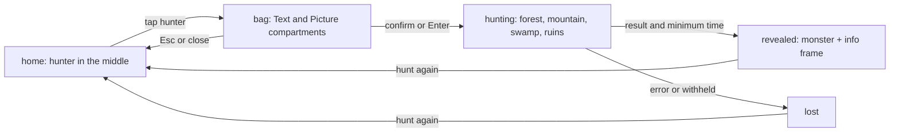

# Design Document

## Overview

One fixed frame with five flow steps. Pure logic in `src/ui/` decides the step,
the journey and the scene. Thin components in `src/components/` draw it with
inline SVG (through an art registry) and CSS keyframes. `runCheck`,
`buildAnalyzeRequest`, `analyzeRequest`, the ingest API and the result view
model are reused unchanged. No change to `src/core`, `src/analyzers`,
`src/pipeline`, `src/server`, `src/app/api`, `src/client` or the API contract.



## A. Pure logic (`src/ui/`)

### A1. `view/flow.ts`

```ts
export type FlowStep = "home" | "bag" | "hunting" | "revealed" | "lost";

export interface Slots { readonly text: boolean; readonly image: boolean }

export interface FlowState { readonly step: FlowStep; readonly slots: Slots }

export type FlowEvent =
  | { readonly kind: "open-bag" }
  | { readonly kind: "close-bag" }
  | { readonly kind: "toggle"; readonly slot: "text" | "image" }
  | { readonly kind: "confirm"; readonly canConfirm: boolean }
  | { readonly kind: "ready" }   // a usable result arrived and the minimum time passed
  | { readonly kind: "fail" }    // failure, nothing to check, or withheld result
  | { readonly kind: "again" };

export function flowReducer(state: FlowState, event: FlowEvent): FlowState;
export function canConfirm(slots: Slots, text: string, file: File | null): boolean;
export function shouldSubmitOnEnter(e: {
  key: string; shiftKey: boolean; isComposing: boolean; canConfirm: boolean;
}): boolean;
```

Rules (REQ-HUNT-06, 07, 16, 18):

| Step | Event | Result |
|---|---|---|
| `home` | `open-bag` | `bag` (slots start with `text: true, image: false`) |
| `bag` | `close-bag` | `home` |
| `bag` | `toggle` | flips that slot |
| `bag` | `confirm` with `canConfirm: true` | `hunting` |
| `hunting` | `ready` | `revealed` |
| `hunting` | `fail` | `lost` |
| `revealed`, `lost` | `again` | `home` (slots reset) |
| any | any other event | same state (no-op) |

`canConfirm`: `(slots.text && text.trim() !== "") || (slots.image && file !== null)`.
Malformed input never throws (wrap in try/catch, return the state).

`shouldSubmitOnEnter`: `key === "Enter" && !shiftKey && !isComposing && canConfirm`.
The component passes `event.nativeEvent.isComposing` (Vietnamese IME).

### A2. `hunt.config.ts` and `view/journey.ts`

```ts
// hunt.config.ts
export const MIN_HUNT_MS = 4000;
```

```ts
// view/journey.ts
export type Leg = "forest" | "mountain" | "swamp" | "ruins";

export function legsFor(hasImage: boolean): readonly Leg[];
// text only: ["forest", "ruins"]; with picture: ["forest","mountain","swamp","ruins"]

export function legFor(args: {
  hasImage: boolean;
  status: CheckStatus;
  elapsedMs: number;
  minMs: number;
}): Leg;

export function revealWaitMs(args: {
  elapsedMs: number; minMs: number; reducedMotion: boolean;
}): number;
```

- Status index in the legs list: `preparing` is the first leg; `qr` is `mountain` (or the first leg without a picture); `ocr-loading` and `ocr-recognizing` are `swamp`; `sending` is the last leg (`ruins`). Without a picture, only `preparing` and `sending` happen.
- Time index: `min(legCount - 1, floor(elapsedMs / (minMs / legCount)))`.
- The Leg is the one at the larger of the two indexes. Bad numbers (NaN, negative) are treated as 0.
- `revealWaitMs` returns `0` when `reducedMotion` is true, else `max(0, minMs - elapsedMs)`.

`App.tsx` keeps `startedAt` in a ref when `confirm` runs. When `runCheck`
resolves it computes `wait = revealWaitMs(...)`, waits that long with
`setTimeout` (cleared on unmount and on "again"), then dispatches `ready` or
`fail`. A timer drives a re-render every ~250 ms while `hunting` so the time
index advances. Both the interval and the timeout are cleared on every path.

### A3. `view/scene.ts`

```ts
export type ScenePhase = FlowStep;

export type SceneInput =
  | { readonly step: "home" }
  | { readonly step: "bag" }
  | { readonly step: "hunting"; readonly leg: Leg }
  | { readonly step: "revealed"; readonly monster: MonsterKey }
  | { readonly step: "lost" };

export interface SceneView {
  readonly phase: ScenePhase;
  readonly leg: Leg | null;
  readonly captionKey: MessageKey;
  readonly monster: MonsterKey | null;
}

export function sceneFor(input: unknown): SceneView; // total; malformed gives "lost"
```

| Input | captionKey | leg | monster |
|---|---|---|---|
| `home` | `scene.home.caption` | `null` | `null` |
| `bag` | `scene.bag.caption` | `null` | `null` |
| `hunting` `forest` | `scene.hunt.forest` | `forest` | `null` |
| `hunting` `mountain` | `scene.hunt.mountain` | `mountain` | `null` |
| `hunting` `swamp` | `scene.hunt.swamp` | `swamp` | `null` |
| `hunting` `ruins` | `scene.hunt.ruins` | `ruins` | `null` |
| `revealed`, monster not `neutral` | `scene.reveal.found` | `null` | that key |
| `revealed`, `neutral` | `scene.reveal.nothing` | `null` | `neutral` |
| `lost` and any malformed input | `scene.lost.caption` | `null` | `null` |

A `revealed` step with a withheld result view is never produced: `App` sends
`fail` instead (REQ-HUNT-10). The reveal caption for a monster takes `{name}`
from `t(locale, monster.nameKey)` in the component.

### A4. `view/info-sections.ts`

```ts
export function splitSections(
  sections: readonly SectionId[],
): { readonly scrolling: readonly SectionId[]; readonly pinned: readonly SectionId[] };
```

`pinned` is `["limitsNote"]` when present, `scrolling` is all others in the
original order. Test: for every view shape, `scrolling` followed by `pinned`
contains exactly the `resultSections` entries (nothing lost, order kept).

### A5. Dictionary (`i18n/en.ts`, `i18n/vi.ts`)

New keys, same set in both languages. English is the source; Vietnamese is a
draft to use as is.

| Key | English | Vietnamese |
|---|---|---|
| `input.submit` (changed) | Start the hunt | Bắt đầu săn |
| `scene.home.caption` | Tap the hunter to open his bag. | Chạm vào bác thợ săn để mở túi của ông. |
| `scene.bag.caption` | What shall the hunter track? Put a message, a picture, or both in the bag. | Bác thợ săn sẽ lần theo gì? Hãy bỏ tin nhắn, hình ảnh hoặc cả hai vào túi. |
| `scene.hunt.forest` | The hunter slips into the dark forest… | Bác thợ săn lách vào khu rừng tối… |
| `scene.hunt.mountain` | He climbs the mountain pass, lantern held high… | Ông leo lên đèo núi, giơ cao ngọn đèn… |
| `scene.hunt.swamp` | He wades through the swamp, reading the strange marks… | Ông lội qua đầm lầy, xem kỹ những ký hiệu lạ… |
| `scene.hunt.ruins` | The ruins ahead. He takes aim at the shadow… | Tàn tích phía trước. Ông nhắm vào cái bóng… |
| `scene.reveal.found` | The shadow was a {name}. | Cái bóng ấy là {name}. |
| `scene.reveal.nothing` | The trail is quiet. No warning signs found, but still check through official channels. | Dấu vết im ắng. Chưa thấy dấu hiệu cảnh báo, nhưng vẫn nên kiểm tra qua kênh chính thức. |
| `scene.lost.caption` | The trail went cold. Please try again. | Dấu vết đã nguội. Hãy thử lại. |
| `home.hunter.action` | Open the hunter's bag | Mở túi của bác thợ săn |
| `bag.heading` | The hunter's bag | Túi của bác thợ săn |
| `bag.text.label` | Written message | Tin nhắn chữ |
| `bag.image.label` | Picture | Hình ảnh |
| `bag.slot.on` | In the bag | Đã bỏ vào túi |
| `bag.slot.off` | Not in the bag | Chưa bỏ vào túi |
| `bag.needOne` | Put a message or a picture in the bag first. | Hãy bỏ tin nhắn hoặc hình ảnh vào túi trước. |
| `bag.enter.hint` | Press Enter to start. Shift and Enter make a new line. | Nhấn Enter để bắt đầu. Shift và Enter để xuống dòng. |
| `bag.close` | Close the bag | Đóng túi |
| `hunt.again` | Hunt again | Săn tiếp |
| `result.frame.label` | Hunt report | Báo cáo cuộc săn |

Existing keys (`input.text.label`, `input.text.hint`, `input.image.*`,
`input.paste.hint`, `privacy.note`, `settings.open`, `progress.*`) are reused.
Tests that pinned the old `input.submit` text are updated in task 1.1 only.
PBT-92 checks `scene.*` and `bag.*`.

### A6. Palette (`theme/palettes.ts`, `theme/pairs.ts`, `globals.css`)

New tokens in `COLOR_TOKENS`, `NORMAL_PALETTE`, `HIGH_CONTRAST_PALETTE`:

| Token | Normal | High contrast | Used for |
|---|---|---|---|
| `sky` | `#120A24` | `#000000` | Backdrop top (art only) |
| `fog` | `#3B2A63` | `#160D26` | Fog (art only) |
| `moon` | `#F3E9C6` | `#FFF6C2` | Moon, glints (art only) |
| `lantern` | `#FFB347` | `#FFC266` | Lantern flame, eyes (art only) |
| `ground` | `#1C1326` | `#000000` | Soil, silhouettes (art only) |
| `foliage` | `#1F3B2D` | `#0B1A12` | Forest and swamp (art only) |
| `stone` | `#4B4260` | `#2A2340` | Mountain, ruins, graves (art only) |
| `water` | `#1E3A52` | `#0A1A2A` | Swamp (art only) |
| `parchment` | `#2E2014` | `#0A0612` | Bag panel background |
| `parchment-text` | `#F5E6C8` | `#FFFFFF` | Text on the bag panel |
| `parchment-border` | `#C9A66B` | `#E3D9FF` | Bag panel border |

Declared pairs added: `parchment-text` on `parchment` (text, AA) and
`parchment-border` on `parchment` (non-text, 3:1). Thresholds do not change; a
failing pair is fixed by changing a palette value. Art-only tokens have no pair
because no text sits on them (REQ-HUNT-47).

## B. Components (`src/components/`)

All new components are presentational, take `locale` and data as props and
contain no hard-coded text. SVGs are `aria-hidden="true"`, `focusable="false"`,
with no `<text>`, `<title>`, `<filter>` or `<animate>`.

| File | Role |
|---|---|
| `art/registry.tsx` | Art registry (B2) |
| `art/backdrops.tsx` | Five backdrops (home, forest, mountain, swamp, ruins) |
| `art/hunter.tsx` | Hunter in six poses |
| `art/bag.tsx` | Bag (closed, open), paper, photo frame |
| `art/shade.tsx` | Shade in 2 to 3 poses |
| `art/monsters.tsx` | Six monsters (replaces `monster-art.tsx`; the old file re-exports from here until removed) |
| `Frame.tsx` | Fixed frame, top bar, layout per step, `data-step` attribute |
| `HunterButton.tsx` | The hunter as a button at `home` |
| `BagPanel.tsx` | The two compartments, fields, confirm, close (replaces `InputForm.tsx`; keeps the `firstImage` export) |
| `HuntScene.tsx` | Backdrop of the current Leg, hunter, shade, caption |
| `MonsterStage.tsx` | The large monster and its caption |
| `InfoFrame.tsx` | Scrolling sections plus pinned limits note |
| `MonsterCard.tsx`, `TechnicalDetails.tsx`, `ResultPanel.tsx` | Edited (B4) |
| `SettingsPanel.tsx`, `Header.tsx` | `Header` becomes the slim top bar; `SettingsPanel` content unchanged |

### B1. Frame and layout

```
<div class="h-dvh overflow-hidden" data-step=...>   fixed frame
  top bar: app name | settings button (panel opens over the frame, scrolls inside)
  stage area (flex-1, min-h-0):
     home      : backdrop + hunter button (center) + caption + privacy note
     bag       : backdrop (dimmed) + hunter (left) + BagPanel (right/below)
     hunting   : backdrop of the leg + hunter + shade + caption + StatusRegion
     revealed  : MonsterStage + InfoFrame   (side by side from md, stacked below md)
     lost      : backdrop + hunter downcast + caption + ErrorAlert + again button
```

- The root has `h-dvh overflow-hidden`. Every flex child uses `min-h-0` so the
  Info frame and the bag panel can scroll inside themselves.
- Scenes scale with the SVG `viewBox` and `preserveAspectRatio="xMidYMax slice"`
  for backdrops, `meet` for the hunter and monsters.
- Landscape on small phones (`max-height` media query): bag and info use two
  columns so nothing is hidden.
- All sizes use `rem`, `%`, `dvh` or `clamp()`. Buttons and toggles use `min-h-11`.
- Text sits on `surface` or `parchment` panels, never directly on art.

### B2. Art registry

```ts
export type ArtId =
  | "backdrop-home" | "backdrop-forest" | "backdrop-mountain"
  | "backdrop-swamp" | "backdrop-ruins"
  | "hunter" | "bag" | "shade"
  | "monster-bank-ghost" | "monster-prize-vampire" | "monster-job-zombie"
  | "monster-authority-banshee" | "monster-generic-shade" | "monster-neutral-candle";

type ArtEntry =
  | { kind: "svg"; Component: (p: { pose?: string; className?: string }) => ReactElement }
  | { kind: "image"; src: string };   // same-origin file under public/hunter/

export function Art(props: { id: ArtId; pose?: string; className?: string }): ReactElement;
```

`Art` renders the SVG component or a decorative `` for
an image entry. `MONSTER_PRESENTATION.artKey` values map to the monster ids.
Unknown ids fall back to `monster-generic-shade`. Swapping a piece for an
image changes one registry line.

### B3. Detail standard for the art

| Piece | Content (all in layered `<g data-part>` groups) |
|---|---|
| Home backdrop | Sky gradient, large moon with glow rings, three layers of dead trees, gravestones and crosses, an iron fence, two fog bands, a pumpkin lantern, bats and a crow |
| Forest | Four depth layers of dark pines and twisted trees, a path, roots, fireflies, mist, owl eyes in a hollow |
| Mountain | Jagged ridges in layers, a snow-lit peak, a rope bridge, drifting clouds, a lone dead tree, stars |
| Swamp | Water with reflections, reeds, dead stumps, lily pads, will-o'-the-wisps, hanging moss, fog |
| Ruins | A broken gate and arches, fallen columns, ivy, cracked floor, an eerie glow from inside, crows |
| Hunter | Hooded cloak with folds and a ragged hem, wide-brim hat with band and buckle, belt, gloves, boots; a lantern with metal frame, layered flame and glow; a crossbow with string and bolt. Six poses: `idle`, `tracking`, `lantern`, `reading`, `aiming`, `downcast`. Each pose changes the arms, head and lantern shape, not only the color |
| Bag | Rough cloth with stitches, flap and clasp (closed and open); a rolled paper with creases; a photo frame with a torn corner |
| Shade | Black silhouette with ragged edges, two glowing eyes, wisps; 2 to 3 running poses |
| Bank Ghost | Sheet ghost with wavy hem, hollow eyes, chains and a vault padlock on the chest |
| Prize Vampire | High-collar cape, fangs, slicked hair, a gift box with a ribbon in the hand |
| Job Zombie | Stitched head and cracked skin, torn suit, a briefcase, a loosened tie |
| Authority Banshee | Long flowing hair, open mouth, hollow eyes, a badge-shaped brooch, torn gown |
| Generic Shade | Hooded shape with an empty face, two glints, drifting smoke tails |
| Neutral Candle | A melted-wax candle in a holder, a calm layered flame, a small moth, a soft glow |

Rules for every piece: 4 to 6 shades from the color tokens (base, dark, light,
accent, eyes); gradients for depth; a shading shape and a rim light; glowing
parts use `lantern` or the monster token; fine details live in groups whose
`data-part` ends with `-detail`, hidden by CSS when `data-high-contrast="true"`.
Budget: each file at most 30 KB, all art at most 350 KB (REQ-HUNT-41).

### B4. Edited components

- `TechnicalDetails.tsx`: shows only the semantic note for a ready view. No
  signal ids, no notice kinds (`Notices` already shows notices in plain words).
  Returns `null` when empty; `ResultPanel` skips the wrapper `<div>` for a `null` node.
- `MonsterCard.tsx`: no art; heading, name, description, tips.
- `ResultPanel.tsx`: unchanged order. `InfoFrame` calls `splitSections` and
  renders `scrolling` inside the scroll region and `pinned` below it.

### B5. Animation (`globals.css`)

Class names use the `th-` prefix. Only `transform` and `opacity` change.

| Class | Effect | Period |
|---|---|---|
| `th-fog-drift` | Fog layers slide sideways a short distance | 40 s alternate |
| `th-sway` | Trees and reeds rotate a few degrees | 9 s alternate |
| `th-flicker` | Lantern glow opacity between 0.85 and 1 | 3 s smooth, no flash |
| `th-fly` | Bats, crows and fireflies drift | 12 to 20 s |
| `th-walk` | Hunter steps (small up and down and sideways) | 1.2 s alternate |
| `th-parallax` | Backdrop layers move at different speeds during a Leg | 8 s linear |
| `th-shade-run` | Shade runs ahead of the hunter | 5 s linear loop |
| `th-leg-in` | A new Leg fades in | 0.8 s once |
| `th-reveal` | The monster fades and scales in from 0.9 and 0 opacity | 0.9 s once |
| `th-lost-fade` | Fog thickens slightly | 1.2 s once |

Rule: the base style of each element is its final state and the keyframes only
describe the start (`from`). With `animation: none` (the existing global
reduced-motion rules) every step is fully visible. No class changes more than a
small amount per second, so nothing flashes.

## C. Wiring in `App.tsx`

- State: `flow` (`FlowState`), `text`, `file`, the `hunting` data (`startedAt`,
  last `status`, `hasImage`), the outcome (`verdict`, `extras`, or a failure
  message). A reducer or `useReducer` holds `flow`.
- Confirm: `dispatch(confirm)` then call `runCheck` with `userText` only when
  the Text compartment is on and `file` only when the Picture compartment is on.
  The `CheckDeps` build is the existing code.
- Outcome: wait `revealWaitMs(...)`, then dispatch `ready` for a usable ready
  view or `fail` for a failed check, `nothing` or a withheld view.
- `buildResultView` is called with the stored verdict as today.
- Existing: preferences load and save, root attributes for text size, motion
  and contrast, the paste listener (now active at `bag` with the Picture
  compartment switched on, and switches it on), focus on the result heading.
- Focus rules: `home` focuses the hunter button; `bag` focuses the bag heading
  and Esc returns focus to the hunter button; `revealed` focuses the result
  heading; "Hunt again" returns focus to the hunter button.
- "Hunt again" clears `text`, `file`, the verdict and the timers.

## Testing strategy

| Layer | How |
|---|---|
| `flow.ts`, `journey.ts`, `scene.ts`, `info-sections.ts` | Unit tests for every table row; PBT-89, 90, 91, 94 |
| Dictionary | Existing key-parity test extended; PBT-92 |
| Markup | `react-dom/server` `renderToStaticMarkup` in the node environment (no new dependency): each step renders the right caption and controls; `HunterButton` is a `<button>` with a name; `BagPanel` shows the hint when it cannot confirm; `InfoFrame` has `tabindex` and a label; PBT-93 |
| Art | `art.test.ts` renders every `ArtId` and every pose: `aria-hidden`, no `<text`, `<title`, `<filter`, `<animate`, at least the number of `data-part` groups set in the task, and file-size budget test |
| Palette | Existing contrast tests with the new tokens and pairs |
| Source scan | `components.boundaries.test.ts` stays green; a new scan forbids `<text`, `<title`, `<filter` in `src/components/art/*.tsx` |
| Visual and responsive | Manual checklist in the final task (widths, text size, high contrast, reduced motion, orientation). Playwright is optional and needs approval for a new dev dependency |

## Risks

- Detailed SVG takes effort and may look uneven. Mitigation: one piece per
  task, reviewed in the real flow before the next, and the registry lets any
  piece be replaced by an original image later.
- Many layers can slow low-end phones. Mitigation: only `transform` and
  `opacity`, no filters or blur, fog as plain semi-transparent shapes, and the
  parallax runs only during the `hunting` step.
- The scene caption and `StatusRegion` can feel repeated. Mitigation: the
  caption is flavour, `StatusRegion` keeps the exact progress and is the only
  live region.
- A fixed frame can hide content at large text sizes. Mitigation: the bag panel
  and the Info frame scroll inside themselves, and the Frame is checked at the
  largest text size and in landscape.
- The 4 second minimum adds delay to quick checks. Mitigation: it is one
  constant, skipped with reduced motion, and the check itself is not delayed.

---

# Revision 2: PixiJS stage, hunter's journal, optional sound

Goal: less cluttered and more like a game, with a scarier mood. The flow, the
journey, `runCheck`, the API and `resultSections` stay as designed above.
Requirements 10 to 14 (`REQ-HUNT-51` to `REQ-HUNT-76`, `PBT-95` to `PBT-99`).

## R2-A. Pure logic

### stagePlan (`src/ui/view/stage-plan.ts`)

```ts
export type StageProfile = "off" | "low" | "normal";

export interface StageLayer {
  readonly id: "fog-far" | "fog-mid" | "fog-near" | "trees" | "vignette" | "lantern-light";
  readonly motion: "still" | "drift" | "sway" | "flicker" | "pulse";
  readonly hz: number;        // cycles per second, 0 for still
  readonly alpha: number;     // 0..1
}
export interface StageParticles {
  readonly kind: "firefly" | "bat" | "crow" | "eyes";
  readonly count: number;     // already capped by the profile
}
export interface StagePlan {
  readonly enabled: boolean;  // false: keep SVG only
  readonly layers: readonly StageLayer[];
  readonly particles: readonly StageParticles[];
  readonly darkness: number;  // 0..1, how dark the scene is (reveal closes it)
  readonly cameraDrift: number; // 0..0.02
  readonly heartbeat: boolean;  // vignette pulse while hunting
}
export function stagePlan(scene: SceneView, prefs: { reduceMotion: boolean }, profile: StageProfile): StagePlan;
```

Rules: `profile: "off"` gives `enabled: false`. Reduced motion keeps only `still` layers
(vignette, lantern light) and no particles. Particle caps: `low` at most 6 in
total, `normal` at most 18. Flicker `hz` at most 1.5, pulse `hz` at most 0.5.
Camera drift 0.02 at most, only while `hunting` or `revealed`. Total, never throws.

`profileFor(env)` (pure) maps `{ hardwareConcurrency, deviceMemory, saveData,
webgl }` to a profile: no WebGL gives `off`; `saveData` or 2 cores or less or
2 GB or less gives `low`; else `normal`. Missing values are treated as `normal`.

### buildJournalView (`src/ui/view/journal.ts`)

```ts
export interface JournalPage1 {
  readonly monsterNameKey: MessageKey; readonly monsterShortKey: MessageKey;
  readonly levelKey: MessageKey; readonly iconKey: string; readonly percent: number;
  readonly actions: readonly string[];          // at most 3
  readonly clues: readonly SignalCardView[];    // at most 3, by severity then order
  readonly note: { key: MessageKey; params?: ... } | null;  // one line
  readonly moreNotes: number;                   // other notes moved to page 2
  readonly limitsNoteKey: MessageKey;
  readonly noSignals: ReadyResultView["noSignals"];
}
export interface JournalView {
  readonly kind: "ready" | "withheld";
  readonly page1: ...; readonly page2: readonly SectionId[]; // sections shown on page 2
}
export function buildJournalView(view: ResultView): JournalView;
```

Clue choice: all cards flattened in group order, sorted by `severityBand`
(high, medium, low) with a stable order, first 3. Note choice: AI note first,
then a warning notice (`payment-qr`, `wifi-qr`), then none; every other notice
counts in `moreNotes`. `page2` is `resultSections(view)` minus `heading`,
`levelBanner` and `limitsNote`; the sections shown in page 1 in short form
(`actions`, `evidence`) are also kept in full on page 2 so nothing is lost.

### soundPlan (`src/ui/view/sound-plan.ts`)

`soundPlan(scene, prefs)` returns `{ cues: Cue[] }`, where a cue is
`{ id: "wind" | "heartbeat" | "creak" | "swell"; gain: number; fadeInS: number; fadeOutS: number; loop: boolean }`.
Off returns no cues. Wind loops at gain 0.06 at every step. Heartbeat loops at
0.12 while `hunting`. Creak plays once at 0.1 when the step becomes `bag`. Swell
plays once at 0.15 at `revealed`. Fades at least 0.5 s. Total, never throws.

### Preferences

`sound: boolean` is added to the closed key set in `src/ui/preferences.ts` with
default `false`.

## R2-B. Stage adapter (`src/components/stage/`)

| File | Role |
|---|---|
| `PixiStage.tsx` | Client component. Renders an `aria-hidden` container, picks the profile, and on idle loads the adapter with `import()`. Shows nothing extra if it fails |
| `stage-adapter.ts` | Receives `{ pixi, container, getPlan }`, builds layers and particles, runs a ticker, applies `stagePlan` changes, pauses when hidden, destroys everything on `dispose()` |
| `light-textures.ts` | Draws radial gradient textures to an offscreen canvas for light, vignette and fog; revokes nothing network-related |
| `svg-texture.ts` | Serializes an art SVG with `XMLSerializer` and turns it into a texture through a same-origin blob URL (revoked after load) |

The only file that mentions `pixi.js` at runtime is `stage-adapter.ts` through
its parameter; `PixiStage.tsx` has the dynamic `import("pixi.js")`.

Dependency record (task 15, REQ-HUNT-51): `pixi.js` 8.23.0, MIT, the registry's
latest version when installed (uploaded about 10 November 2026, read from the
registry upload timestamp). As bundled by Next.js it is split into lazy chunks of
about 240 KB gzip in total (about 865 KB raw); the page's first-load JS is not
affected (about 121 KB shared). `npm audit` lists no issue in `pixi.js` or its
dependencies (nine existing findings elsewhere are unchanged). `@pixi/react` was
not added.

## R2-C. Journal components

| File | Role |
|---|---|
| `JournalSheet.tsx` | The paper. Ragged edge by `clip-path`, stains as SVG shapes, handwriting headings, two pages with a turn animation (`transform`, `opacity`) |
| `JournalPageOne.tsx` | The condensed note |
| `JournalPageTwo.tsx` | The scrolling full notes (reuses `renderSection`) |
| `fonts.ts` | `next/font` self-hosted heading font with a Vietnamese subset |

No `border` utilities and no `rounded-xl` cards inside these files.

## R2-D. Bag without boxes

`BagPanel.tsx` keeps its props and behaviour. Its markup changes: pockets are
SVG pieces behind real `<button aria-pressed>` controls; the text field sits on
a ruled-paper background with no border; the picture control is a photo frame
with the real `<input type="file">`; the confirm button is a wax seal.

## R2-E. Audio

| File | Role |
|---|---|
| `src/components/audio/audio-host.ts` | Receives `{ createContext }` and a plan; creates the context after a user gesture; builds noise and oscillator graphs; suspends on `visibilitychange`; `dispose()` closes |
| `SoundSwitch` in `SettingsPanel.tsx` | Text-labelled switch bound to `prefs.sound` |

## R2-F. Testing for revision 2

| Layer | How |
|---|---|
| `stagePlan`, `profileFor`, `buildJournalView`, `soundPlan` | Unit tests and PBT-95, PBT-96, PBT-97 |
| Preferences | PBT-98 |
| Dictionary | PBT-99 |
| Stage adapter and audio host | Tests with fake `pixi`/`AudioContext` objects: create, apply plan, hidden tab, dispose, failure paths |
| Source scans | `pixi.js` only inside `src/components/stage/`, only through `import()` or parameters; no `fetch`/URL literals; no `border`/`rounded-xl` in journal and bag files |
| Dependencies | A test reads `package.json` and checks `pixi.js` is an exact version and there is no `@pixi/react` |
| End to end | Existing Playwright flow updated for the journal and the sound switch; network assertions stay |
