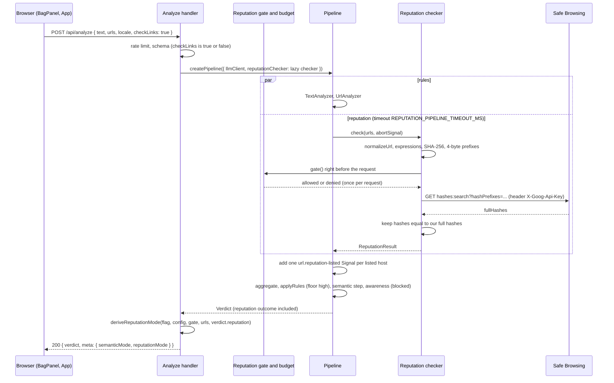

# Design Document

## Overview

`link-reputation-check` adds an optional, consented lookup of the links in one
scan against Google Safe Browsing. The server asks `hashes.search` for the
4-byte SHA-256 prefixes of each link's URL expressions, compares the returned
full hashes with its own, and hands the pipeline a `ReputationResult`. A match
becomes one ordinary Signal, `url.reputation-listed`. The aggregator, the
combination rules and the monster selection stay in charge of the score.

What changes, in one line each:

- **Client:** an unticked Consent_Box in the bag; `checkLinks: true` in the request only when ticked and a link exists; a reputation note in the result.
- **API:** `checkLinks` in the strict schema; a lazy per-request budget gate; `meta.reputationMode`; `reputationMode` in the log event.
- **Pipeline:** an injected `ReputationChecker` that runs concurrently with the analyzers; `Verdict.reputation`; one Signal per listed host; a `high` floor rule.
- **Server:** new `src/server/reputation/` (config, URL expressions, Safe Browsing adapter, checker, fake).
- **UI:** an eighth link creature (Plague Mark), a notice and a Not_Listed_Note, new dictionary keys.
- **Docs and steering:** five steering edits (exact wording below), README, `.env.example`.

`src/core/` and `UrlAnalyzer` are not touched. No new dependency is added.

### Research findings (Google Safe Browsing v5, checked for this design)

| Topic | Finding | Source |
|---|---|---|
| Method | `GET https://safebrowsing.googleapis.com/v5/hashes:search`. The request body must be empty. Prefixes go in the repeated query parameter `hashPrefixes`. | [hashes.search](https://developers.google.com/safe-browsing/reference/rest/v5/hashes/search) |
| Prefix length | Each prefix must be exactly 4 bytes today (the page says this may be relaxed later). Base64, and the overview example `hashPrefixes=WwuJdQ` shows the unpadded web-safe form for 4 bytes. | same, and [Overview](https://developers.google.com/safe-browsing/reference) |
| Prefix count | Clients must not send more than 1000 prefixes. After the URL procedure, clients should not need more than 30 per URL. | same |
| Response | `{ "fullHashes": [ { "fullHash": <base64, 32 bytes>, "fullHashDetails": [ { "threatType": <enum>, "attributes": [<enum>] } ] } ], "cacheDuration": "<n>s" }`. No match is HTTP 200 with `fullHashes` empty, not 404. | same |
| Forward compatibility | New `ThreatType` and `ThreatAttribute` values may appear. A client must disregard a `FullHashDetail` it considers invalid. `CANARY` means "not for enforcement". `FRAME_ONLY` means "only for frames". | same |
| Threat types | `MALWARE`, `SOCIAL_ENGINEERING`, `UNWANTED_SOFTWARE`, `POTENTIALLY_HARMFUL_APPLICATION`, and `THREAT_TYPE_UNSPECIFIED` (disregard). | [hashList](https://developers.google.com/safe-browsing/reference/rest/v5/hashList) |
| Mode | "No-storage real-time mode": no local database, every check goes to the server, higher quota use. The documented procedure also keeps an in-memory cache and returns SAFE on any error. TrickHunt keeps no cache (REQ-LREP-07) and never turns an error into "safe". | [No Storage Real Time Mode](https://developers.google.com/safe-browsing/reference/No.Storage.Real.Time.Mode) |
| URL processing | Canonicalize, then build up to 30 host-suffix/path-prefix expressions (at most 5 hosts x 6 paths), SHA-256 each, send the first 4 bytes. Sending more than 4 bytes "will compromise user privacy". | [URLs and Hashing](https://developers.google.com/safe-browsing/reference/URLs.and.Hashing) |
| Why not `urls.search` | It sends the raw URL, and its terms allow Google to use and share submitted URLs. `hashes.search` is the confidential method. | [Overview](https://developers.google.com/safe-browsing/reference), [Terms](https://developers.google.com/safe-browsing/terms) |
| API key | Passed as `key=` query parameter (docs example) or as header `X-Goog-Api-Key` (platform system parameter). | [System parameters](https://docs.cloud.google.com/apis/docs/system-parameters) |
| Quota | A default quota is given when the API is enabled. The number is not published in the docs; it is shown in the Google Cloud Console and more can be requested. | [Appropriate Usage](https://developers.google.com/safe-browsing/reference/Appropriate.Usage) |
| Cost and use | Free. **Non-commercial use only** (not for sale or revenue-generating purposes), otherwise use Web Risk. | [Appropriate Usage](https://developers.google.com/safe-browsing/reference/Appropriate.Usage), [Terms](https://developers.google.com/safe-browsing/terms) |
| Terms 2 and 3 | Before a user starts, and with each warning, give attribution and a conspicuous notice that reliability and accuracy cannot be guaranteed. Do not use the Google attribution on warnings that do not come from the Google list. | [Terms](https://developers.google.com/safe-browsing/terms) |
| Terms 4 | A URL from the list may not be shown as unsafe unless fresh data came from the API in the last 30 minutes. A live call per scan satisfies this. | same |
| Warning wording | Do not lead users to believe the page is certainly unsafe. Qualify with words such as suspected, potentially, possible, likely, may be. Show the line "Advisory provided by Google" with a link to the Safe Browsing Advisory. | [User warnings](https://developers.google.com/safe-browsing/v4/usage-limits), [Appropriate Usage](https://developers.google.com/safe-browsing/reference/Appropriate.Usage) |

Content was rephrased for compliance with licensing restrictions.

### Decisions

| # | Decision | Why |
|---|---|---|
| D1 | Use `hashes.search`, one GET per scan, all prefixes in one request, API key in the `X-Goog-Api-Key` header. | Confidentiality (4-byte prefixes). One request keeps quota use and latency bounded. A header keeps the key out of URLs, error messages and any URL log. |
| D2 | No local database, no cache, no retry. Ignore `cacheDuration`. | REQ-LREP-07 and REQ-LREP-23. The cost is more quota use (documented trade-off of the no-storage mode). |
| D3 | `MAX_PREFIXES_PER_REQUEST = 100`. | Well under the hard limit of 1000. Five links at about 10 to 20 expressions each fit. The GET URL stays near 2 KB. |
| D4 | Host suffixes are built without the Public Suffix List: the exact host plus up to four shortest suffixes of two or more labels. | This is a superset of Google's set for the common case (eTLD+1 of one or two labels), so no listed host is missed. It avoids a new dependency (NFR-LREP-05). The cost is a few extra prefixes such as `co.uk/`. Rejected: adding `tldts` (new dependency, list ages). |
| D5 | Only `FullHashDetail` entries with a known threat type and no attributes count. A detail with any attribute (`CANARY`, `FRAME_ONLY`, unknown) is disregarded. | Google says a client must disregard details it does not understand, and `CANARY` and `FRAME_ONLY` are not for enforcement of a top-level link. A hash with no usable detail is not Listed. |
| D6 | Unknown but valid threat type strings map to `"other"` (REQ-LREP-24). `THREAT_TYPE_UNSPECIFIED` and empty strings are disregarded. | Keeps REQ-LREP-24 and the Google rule for invalid values. |
| D7 | Attribution is the line "Advisory provided by Google" with a link to the Safe Browsing Advisory, shown only on the Listed explanation. The dictionary names the provider "Google". | The terms require exactly this line and a link. "Safe" in "Google Safe Browsing" would break the dictionary rule REQ-UI-06 and REQ-LREP-41, so the dictionary says "Google". README may say "Google Safe Browsing". |
| D8 | The attribution link is the one clickable element in the app. It lives in its own component `ReputationAttribution.tsx`, opens in a new tab with `rel="noopener noreferrer"` and `referrerPolicy="no-referrer"`, and its address is a constant in `src/ui/reputation.config.ts`. | The terms ask for a link. `ui-rules.md` says links are plain text, which is about scanned links; this is TrickHunt's own attribution. **Needs maintainer confirmation.** Fallback: render the address as plain text and change one component. |
| D9 | `off` (calls per minute or per day set to 0) behaves like "not configured": no checker is created and the mode is `"not-configured"`. | The operator turned the feature off. The user notice is the same neutral text. |
| D10 | The budget reuses `createLlmBudget` (a generic sliding window) from the composition root, typed as `ReputationBudget`. | No duplicate limiter and no import cycle between `src/server/api` and `src/server/reputation`. |
| D11 | The floor is a combination rule `reputation-listed` with `minLevel: "high"` and severity `0.75`, both in `rules.config.ts`. | A single listed link alone scores 75 (`high`); the rule keeps the floor if severity is retuned. "Critical for a listed link alone" is left open as in the requirements (Assumption 3). |
| D12 | Several Listed hosts give several Signals but one scoring unit: `reduceForScoring` keeps the strongest signal per id. No overlap group is added. | Same rule as other ungrouped signals, so a second listed link does not push the score to 100 by itself. |

### Tensions with the approved requirements (please confirm)

These are places where the requirements cannot all hold as written. The design picks the least surprising reading and lists the change needed in `requirements.md`.

1. **Route `maxDuration` must change from 15 to 20.** REQ-LREP-25 needs `REPUTATION_PIPELINE_TIMEOUT_MS` above the largest allowed `LINK_REPUTATION_TIMEOUT_MS` (6000), so it is 6500. REQ-LREP-26 then needs `6500 + 9000 <= maxDuration * 1000 - 2000`. With 15 s this fails (15 500 > 13 000). With 20 s it passes (15 500 <= 18 000). This edits `route.ts`, `route.test.ts` (REQ-API-02 value), the README sentence and the comment in `ingest.config.ts`. The client timeout (20 s) stays above the server worst case (about 16 s). The "Existing Requirements and Tests Modified" table does not list this.
2. **Budget denial and "no checker passed" (REQ-LREP-14, PBT-124).** The budget is acquired lazily (REQ-LREP-16), so the handler cannot know a denial before it calls `createPipeline`. The handler passes a lazy checker; a denied gate returns `degraded / rate-limited` without any provider call. Signals, level, score, monster and actions equal a run with no checker. Only `verdict.reputation` differs (`degraded` instead of `not-requested`). PBT-124 is read as "no provider call and an identical rule-based verdict".
3. **`checked` with nothing looked up (REQ-LREP-15).** If every URL fails to normalize, the pipeline analyzed URLs but the checker made no request (`checkedCount: 0`). "Otherwise `checked`" would show "Not found on the lists we checked" for nothing checked. The design derives `"skipped"` when `reputation.status` is `ok` and `checkedCount` is 0, in addition to zero analyzed URLs.
4. **"Listed" and ignored details (REQ-LREP-05, PBT-120).** A matching full hash whose details are all disregarded (D5) is not Listed. The property is stated for hashes with at least one enforceable detail.
5. **Provider name wording (REQ-LREP-49).** The example "Google Safe Browsing" cannot appear in a dictionary value (REQ-UI-06 and `/safe/` scans). The dictionary says "Google" (D7).
6. **Link Spotlight is not built yet.** `ui-page` group 8 (Part D) is still unchecked in `tasks.md`; `EvidenceList` still renders the badges. REQ-LREP-55 and REQ-LREP-54 assume the spotlight. Tasks must run after ui-page group 8, or add the spotlight first.
7. **Principle 3 in `product.md`.** The requirements table says principle 3 changes, REQ-LREP-66 lists only the "done" line. Principle 3 is about storage, and the lookup stores nothing, so only the "done" line changes.
8. **REQ-LREP-33 needs no code change.** `BLOCKING_SIGNAL_IDS` already contains `url.*`, so the awareness adjustment never lowers a result with a listing signal. The design adds the explicit id as a guard and a test.

### Release conditions (maintainer checklist, not code)

1. Keep TrickHunt non-commercial, or switch to Web Risk.
2. Read the real default quota in the Google Cloud Console. If it is below 2000 per day or 10 per minute, set lower values in `.env`.
3. Run one manual smoke check with a Safe Browsing test page from `testsafebrowsing.appspot.com` (the host used in Google's own example).
4. Review the Vietnamese texts and the creature name.
5. Confirm D8 (attribution link).
6. Confirm the hosting plan allows `maxDuration = 20`.

## Architecture

### Module layout

```
src/
  analyzers/
    reputation-checker.ts         NEW  types only + REPUTATION_LISTED_SIGNAL_ID (no I/O)
  server/
    reputation/                   NEW
      reputation.config.ts        endpoint, MAX_PREFIXES_PER_REQUEST, threat table, response cap
      reputation-config.ts        readReputationConfig(env): the only reader of LINK_REPUTATION_*
      url-expressions.ts          canonicalize, host-suffix/path-prefix expressions, SHA-256, prefixes
      safe-browsing-provider.ts   one GET, timeout, zod validation, status mapping
      reputation-checker.ts       createReputationChecker({ provider, gate, maxPrefixes })
      fake-reputation-provider.ts FakeReputationProvider for tests
      index.ts                    public exports
    api/
      analyze-request.ts          + checkLinks
      analyze-handler.ts          + reputation deps, lazy gate, meta.reputationMode
      reputation-gate.ts          NEW  per-request memoized gate over a ReputationBudget
      reputation-mode.ts          NEW  deriveReputationMode (pure)
      log-event.ts                + reputationMode
      default-handler.ts          + wiring
  pipeline/
    reputation.ts                 NEW  runReputation, listingSignals (pure apart from the injected checker)
    reputation.config.ts          NEW  category labels, priority, why-text
    pipeline.config.ts            + REPUTATION_PIPELINE_TIMEOUT_MS
    rules.config.ts               + REPUTATION_LISTED_SEVERITY, rule "reputation-listed"
    awareness.config.ts           + "url.reputation-listed" in BLOCKING_SIGNAL_IDS
    messages.config.ts, messages.ts  + LIMITATIONS_REPUTATION
    verdict.ts, pipeline.ts       + ReputationOutcome, reputationChecker option
  client/ingest/                  analyze-input.ts, analyze-client.ts, types.ts: checkLinks, reputationMode
  ui/
    link-creatures.ts             + eighth entry, optional explanationKey
    reputation.config.ts          NEW  ADVISORY_URL constant
    view/reputation-note.ts       NEW  buildReputationNote (pure)
    view/result-view.ts, page-layout.ts, journal.ts, notices.ts  + reputationNote
    i18n/en.ts, vi.ts, signal-ids.ts, voice.ts                    + keys, id, tier rule
    theme/palettes.ts, pairs.ts                                   + link-plague-mark
    run-check.ts                  + checkLinks, reputationMode
  components/
    BagPanel.tsx                  + Consent_Box
    ReputationNote.tsx            NEW
    ReputationAttribution.tsx     NEW  the one anchor (D8)
    LinkSpotlight.tsx             (ui-page group 8) renders the note when creatures exist
    ResultPanel.tsx, EvidenceList.tsx, App.tsx   edited
    art/link-creatures.tsx        + creature-plague-mark
  app/api/analyze/route.ts        maxDuration 20
```

### Data flow



### Dependency rules

- `src/pipeline` imports `ReputationChecker` types from `src/analyzers/reputation-checker.ts` and nothing from `src/server` (REQ-LREP-67, 68, `verdict-rules.md`).
- `src/server/reputation` imports `normalizeUrl` from `src/analyzers/url-analyzer` and the types from `src/analyzers/reputation-checker`. It imports nothing from `src/pipeline`, `src/ui`, `src/components` or browser-only packages (REQ-LREP-67).
- `src/server/api` imports the checker type and `createReputationChecker` factory type only through `src/server/reputation/index.ts`. `src/pipeline`, `src/core`, `src/analyzers`, `src/ui`, `src/client` import nothing from `src/server/reputation` (REQ-LREP-68). A boundary test enforces both lists.
- The only outbound host is `safebrowsing.googleapis.com`, written once in `reputation.config.ts`. A source scan fails on that string anywhere else.
- The client sends only to `/api/analyze` (REQ-LREP-09); the existing `boundaries.test.ts` scan stays.

### Timing budget

| Step | Limit | Where |
|---|---|---|
| Provider request | `LINK_REPUTATION_TIMEOUT_MS` (default 3000, 500 to 6000) | adapter `AbortController` |
| Reputation in the pipeline | `REPUTATION_PIPELINE_TIMEOUT_MS = 6500` | `pipeline.config.ts` |
| Semantic step (after rules and reputation) | `SEMANTIC_TIMEOUT_MS = 9000` | unchanged |
| Worst case sum | 15 500 ms | |
| Route `maxDuration` | 20 s (was 15) | `route.ts` |
| Margin required by REQ-LREP-26 | at least 2000 ms | test reads the constants |

## Components and Interfaces

### A. Types (`src/analyzers/reputation-checker.ts`)

Types and one constant only. No I/O, no imports.

```ts
export const REPUTATION_LISTED_SIGNAL_ID = "url.reputation-listed" as const;

export type ReputationCategory =
  | "social-engineering" | "malware" | "unwanted-software" | "other";

export interface ReputationHit {
  readonly url: string;                 // the input URL as the caller gave it; stays in memory
  readonly category: ReputationCategory;
}

export type ReputationDegradedReason =
  | "timeout" | "provider-error" | "invalid-response" | "rate-limited";

export type ReputationResult =
  | { readonly status: "ok"; readonly hits: readonly ReputationHit[];
      readonly checkedCount: number; readonly reason?: "too-many-links" }
  | { readonly status: "degraded"; readonly reason: ReputationDegradedReason };

export interface ReputationChecker {
  /** Never rejects or throws, for any input (REQ-LREP-19). */
  check(urls: readonly string[], signal?: AbortSignal): Promise<ReputationResult>;
}
```

### B. Server module `src/server/reputation/`

**`reputation.config.ts`** (pure data, no imports except the category type):

```ts
export const REPUTATION_ENDPOINT = "https://safebrowsing.googleapis.com/v5/hashes:search";
export const HASH_PREFIX_BYTES = 4;
export const MAX_PREFIXES_PER_REQUEST = 100;      // hard provider limit is 1000
export const MAX_RESPONSE_CHARS = 262_144;
export const MAX_HOST_SUFFIXES = 4;               // plus the exact host (D4)
export const MAX_PATH_DIRECTORIES = 4;            // "/", "/a/", "/a/b/", "/a/b/c/"

export const THREAT_CATEGORY_BY_TYPE: Readonly<Record<string, ReputationCategory>> = {
  SOCIAL_ENGINEERING: "social-engineering",
  MALWARE: "malware",
  UNWANTED_SOFTWARE: "unwanted-software",
  POTENTIALLY_HARMFUL_APPLICATION: "other",
};
export const DISREGARDED_THREAT_TYPES: readonly string[] = ["THREAT_TYPE_UNSPECIFIED", ""];
/** Attributes that still allow enforcement. Today none: any attribute disregards the detail (D5). */
export const ENFORCEABLE_ATTRIBUTES: readonly string[] = [];

export const REPUTATION_CONFIG_LIMITS = {
  timeoutMs: { default: 3000, min: 500, max: 6000 },
  callsPerMinute: { default: 10, min: 0, max: 60 },
  callsPerDay: { default: 2000, min: 0, max: 10000 },
} as const;
```

**`reputation-config.ts`**, the only reader of the four `LINK_REPUTATION_*` keys:

```ts
export type ReputationConfigState = "ready" | "not-configured" | "off";
export interface ReputationConfig {
  readonly state: ReputationConfigState;
  /** Non-enumerable like LlmConfig.apiKey: absent from JSON.stringify, spread and console.log. */
  readonly apiKey: string;              // "" unless state is "ready"
  readonly timeoutMs: number;
  readonly callsPerMinute: number;
  readonly callsPerDay: number;
}
export function readReputationConfig(
  env?: Readonly<Record<string, string | undefined>>,
): ReputationConfig;
```

Rules: never throws; a missing or non-object `env` gives defaults with state `not-configured`. Each numeric value must match `/^\d+$/` after trim, else the default; leading zeros are stripped and the value is clamped (more than 15 significant digits counts as the maximum). Key missing, blank or not a string gives `not-configured`. Otherwise, if either call limit is 0 after clamping, `off`. Otherwise `ready`. Zod validates the picked object, as `readApiConfig` does.

**`url-expressions.ts`** (pure; the only module that imports `node:crypto`):

```ts
export interface LookupUrl {
  readonly host: string;          // canonical, lower case, punycode, no port, no userinfo
  readonly isIpLiteral: boolean;
  readonly path: string;          // canonical, starts with "/"
  readonly query: string | null;  // canonical, without "?"; null when absent or empty
}
export function toLookupUrl(input: string): LookupUrl | null;       // uses normalizeUrl first
export function expressionsOf(url: LookupUrl): readonly string[];   // distinct, at most 30
export function sha256(text: string): Uint8Array;                    // 32 bytes
export function prefixOf(hash: Uint8Array): Uint8Array;              // first 4 bytes
export function toBase64Url(bytes: Uint8Array): string;              // unpadded, web-safe
export function fromBase64Any(text: string): Uint8Array | null;     // standard or web-safe, padded or not
```

Canonicalization follows Google's procedure (see the research table), with these points fixed here:

1. `normalizeUrl(input)` first (REQ-LREP-20). `null` gives `null`. Then `new URL(normalized)`. The WHATWG parser already lower-cases and punycodes the host, normalizes IPv4 spellings to dotted decimal, compresses IPv6, drops the fragment, tab, CR and LF, and keeps userinfo and port apart. Userinfo, port, scheme and fragment never enter an expression.
2. Host: remove leading and trailing dots, collapse repeated dots, lower-case. A bracketed IPv6 form of an IPv4-mapped address (`::ffff:a.b.c.d`) or a NAT64 address under `64:ff9b::/96` is converted to the IPv4 dotted form. An empty host after cleaning gives `null`.
3. Path and query: take `pathname + search` from the parsed URL, repeatedly percent-unescape until no `%XX` remains (the string shrinks each round, so the loop ends), then resolve `/./` and `/../` and collapse runs of `/` in the **path only**, then re-escape every byte that is `<= 0x20`, `>= 0x7F`, `#` or `%` with upper-case hex. An empty query is treated as no query.
4. Hosts for expressions: for an IP literal, the host only. Otherwise the exact host plus the `MAX_HOST_SUFFIXES` shortest suffixes that have at least two labels (D4), distinct.
5. Paths: the exact path with query (if any), the exact path, then `/` and up to three more directory prefixes with a trailing slash, distinct. At most 6 per host, so at most 30 expressions per URL.
6. An expression is `host + path` (with `?query` for the first path form), with no scheme.

Test vectors (from Google's page): `http://a.b.com/1/2.html?param=1` gives `a.b.com/1/2.html?param=1`, `a.b.com/1/2.html`, `a.b.com/`, `a.b.com/1/`, `b.com/1/2.html?param=1`, `b.com/1/2.html`, `b.com/`, `b.com/1/`. `http://1.2.3.4/1/` gives `1.2.3.4/1/`, `1.2.3.4/`. `http://example.co.uk/1` gives `example.co.uk/1`, `example.co.uk/` (and `co.uk/1`, `co.uk/` from D4).

**`safe-browsing-provider.ts`**: the wire adapter.

```ts
export type ProviderMatch = {
  readonly fullHash: Uint8Array;                 // 32 bytes
  readonly categories: readonly ReputationCategory[];   // from enforceable details only
};
export type HashSearchResult =
  | { readonly status: "ok"; readonly matches: readonly ProviderMatch[] }
  | { readonly status: "degraded"; readonly reason: ReputationDegradedReason };

export interface ReputationProvider {
  searchHashes(prefixes: readonly Uint8Array[], signal?: AbortSignal): Promise<HashSearchResult>;
}
export function createSafeBrowsingProvider(options: {
  readonly apiKey: string;
  readonly timeoutMs: number;
  readonly fetchImpl: typeof fetch;
}): ReputationProvider;
```

Request: `GET REPUTATION_ENDPOINT?hashPrefixes=<b64url>&hashPrefixes=...` with prefixes sorted (hides input order). Headers: `X-Goog-Api-Key`, `Accept: application/json`. Options: `method: "GET"`, `cache: "no-store"`, `redirect: "error"`, `credentials: "omit"`, `referrerPolicy: "no-referrer"`, `signal`. No `quotaUser` and no other identifying parameter (REQ-LREP-04). No retry (REQ-LREP-23).

Response handling, in this order: abort or timeout gives `timeout`; thrown network error gives `provider-error`; status 429 gives `rate-limited`; any other non-200 gives `provider-error`; body longer than `MAX_RESPONSE_CHARS`, unparsable JSON or a zod failure gives `invalid-response`. The zod schema is a loose object (unknown fields ignored):

```ts
const detailSchema = z.looseObject({
  threatType: z.string(),
  attributes: z.array(z.string()).optional(),
});
const responseSchema = z.looseObject({
  fullHashes: z.array(z.looseObject({
    fullHash: z.string(),
    fullHashDetails: z.array(detailSchema).optional(),
  })).optional(),
});
```

An absent `fullHashes` is an empty list. A `fullHash` that does not decode to exactly 32 bytes gives `invalid-response`. A detail is enforceable when `threatType` is not in `DISREGARDED_THREAT_TYPES` and every attribute is in `ENFORCEABLE_ATTRIBUTES`. The category is `THREAT_CATEGORY_BY_TYPE[type]` when present (own property), else `"other"` (REQ-LREP-24). A match with no enforceable detail is dropped.

**`reputation-checker.ts`**:

```ts
export function createReputationChecker(options: {
  readonly provider: ReputationProvider;
  /** Called once, right before the provider request, only when at least one prefix exists. */
  readonly gate: () => boolean;
  readonly maxPrefixes?: number;     // default MAX_PREFIXES_PER_REQUEST
}): ReputationChecker;
```

`check(urls, signal)` steps (all inside one `try/catch`; any throw gives `degraded / provider-error`):

1. Keep string items; `toLookupUrl` each; skip `null`; skip repeats of the same canonical URL. Keep the original input string for the hit.
2. For each kept URL in input order compute expressions, hashes and prefixes. Add the URL while the distinct prefix count stays within `maxPrefixes`; stop at the first URL that does not fit and remember `tooMany`.
3. No URL kept: return `{ status: "ok", hits: [], checkedCount: 0 }` (plus `reason: "too-many-links"` when `tooMany`). No gate call, no request (REQ-LREP-29).
4. `gate()` false or throwing: return `degraded / rate-limited`.
5. `provider.searchHashes(sortedDistinctPrefixes, signal)`. A `degraded` result is returned as is.
6. A URL is a hit when the full hash of any of its expressions equals a returned `fullHash`. The checker emits one `ReputationHit` per matched URL and distinct category; the pipeline picks one category per host (`CATEGORY_PRIORITY`). Return `{ status: "ok", hits, checkedCount: keptUrls, reason? }`.

Full-hash comparison is on hex strings of 32 bytes. A prefix match without a full-hash match is never a hit (REQ-LREP-05).

**`fake-reputation-provider.ts`**: `FakeReputationProvider` implements `ReputationProvider`. Factories: `responding(matches)`, `degraded(reason)`, `throwing()`, `hanging()` (never resolves, honors `signal`), and `listing(urls)` which computes the real full hashes of the given URLs so a test can build an honest listing. It records every call in `calls` (prefixes and whether a signal was passed) for the privacy tests. A second helper, `fakeFetchCapturing(responseFactory)`, records the URL, headers and options a real adapter sends, so tests need no network.

### C. Pipeline

**`verdict.ts`**:

```ts
export type ReputationStatus = "ok" | "degraded" | "not-requested";
export type ReputationReason =
  | "timeout" | "provider-error" | "invalid-response" | "rate-limited" | "too-many-links";
export interface ReputationOutcome {
  readonly status: ReputationStatus;
  readonly reason?: ReputationReason;
  readonly checkedCount: number;          // integer >= 0
}
export interface Verdict { /* existing fields */ readonly reputation: ReputationOutcome; }
```

**`pipeline.ts`**: `PipelineOptions` gains `reputationChecker?: ReputationChecker | null` and the test hook `reputationTimeoutMs?: number`. In `run`, right after `prepareInput` and before the analyzers are awaited:

```ts
const reputation = runReputation(checker, prepared.urls, timeoutMs, locale); // started, not awaited
... analyzers as today ...
const rep = await reputation;                                                // never rejects
const ruleSignals = shortenEvidence([...textSignals, ...urlResults.flat(), ...rep.signals]);
```

The rest of `run` is unchanged: `score(ruleSignals)`, the semantic policy, the awareness adjustment, `assemble`. `assemble` takes `reputation: ReputationOutcome` and `reputationListed: boolean` (for the limitation). `fallbackVerdict` and the `prepared.empty` branch set `reputation` too: `{ status: "not-requested", checkedCount: 0 }` without a checker, and `{ status: "ok", checkedCount: 0 }` with a checker and no URL.

**`reputation.ts`**:

```ts
export interface ReputationRun {
  readonly outcome: ReputationOutcome;
  readonly signals: readonly Signal[];
}
export function runReputation(
  checker: ReputationChecker | null, urls: readonly string[],
  timeoutMs: number, locale: Locale,
): Promise<ReputationRun>;                         // never rejects
export function listingSignals(
  hits: readonly ReputationHit[], locale: Locale,
): Signal[];                                       // pure
```

`runReputation`: no checker gives `not-requested`; no URLs gives `{ ok, checkedCount: 0 }` without calling the checker. Otherwise it creates an `AbortController`, starts `checker.check(urls, controller.signal)` inside `try/catch`, and races it with a timer. On timeout it aborts the controller and returns `degraded / timeout`. A result that is not an object with `status` `"ok"` or `"degraded"`, with a numeric `checkedCount` and an array `hits`, counts as `degraded / invalid-response`. The timer is always cleared. `ok` copies `reason` only when it is `"too-many-links"`.

`listingSignals`: for each hit, `host = new URL(normalizeUrl(hit.url)).hostname` (a failure skips the hit); group by host; the category with the lowest index in `CATEGORY_PRIORITY` wins; one `createSignal({ id: REPUTATION_LISTED_SIGNAL_ID, source: "url", severity: REPUTATION_LISTED_SEVERITY, evidence: `${host} (${label})`, whyItMatters })` per host, in first-seen order. Evidence holds the host and the label only: no path, query, fragment or userinfo (REQ-LREP-30). A `createSignal` throw skips that host.

**Config files**

- `pipeline.config.ts`: `export const REPUTATION_PIPELINE_TIMEOUT_MS = 6500;`
- `rules.config.ts`: `export const REPUTATION_LISTED_SEVERITY = 0.75;` and the rule `{ id: "reputation-listed", allOf: [["url.reputation-listed"]], minLevel: "high" }`. The id also matches the existing `url.*` patterns, so rules such as `sensitive-data-with-link` and `otp-with-context` fire for a listed link, as for any link.
- `reputation.config.ts` (pipeline): `CATEGORY_PRIORITY = ["social-engineering", "malware", "unwanted-software", "other"]`; `CATEGORY_LABELS` by locale; `LISTED_WHY` by locale.
- `awareness.config.ts`: add `"url.reputation-listed"` to `BLOCKING_SIGNAL_IDS` (already covered by `url.*`; the explicit id survives a later relaxation of `url.*`).
- `messages.config.ts`: `LIMITATIONS_REPUTATION` by locale; `buildLimitations` gets `reputationListed?: boolean` and adds it once (REQ-LREP-37).

English category labels: `social-engineering` "reported as deceptive", `malware` "reported for harmful software", `unwanted-software` "reported for unwanted software", `other` "reported site". English `LISTED_WHY`: "The link appears on a list of reported sites." English limitation: "The list of reported sites only covers sites that were already reported. A new or unreported link is not on it yet." Vietnamese versions are drafts (table in the Data Models section).

### D. API handler

**`analyze-request.ts`**: the strict schema gains `checkLinks: z.boolean().optional()`. `z.boolean()` rejects `null`, strings, numbers, arrays and objects (REQ-LREP-11). The existing refine (non-blank text or at least one URL) already makes a body with only `checkLinks` invalid (REQ-LREP-12). `ParsedRequest.input` gains `checkLinks?: boolean`.

**`reputation-gate.ts`**:

```ts
export interface ReputationBudget { tryAcquire(): boolean; }   // same shape as LlmBudget
export type GateOutcome = "used" | "denied" | "skipped";
export interface ReputationGate {
  readonly gate: () => boolean;      // first call acquires, later calls return the same answer
  outcome(): GateOutcome;            // "skipped" when gate was never called
}
export function createReputationGate(budget: ReputationBudget): ReputationGate;
```

A throwing budget counts as denial. The memo gives "at most once per request" (REQ-LREP-16).

**`reputation-mode.ts`** (pure and total):

```ts
export type ReputationMode =
  "checked" | "not-requested" | "not-configured" | "budget-exhausted" | "skipped" | "failed";
export type LogReputationMode = ReputationMode | "none";

export function deriveReputationMode(input: {
  readonly checkLinks: boolean;
  readonly configured: boolean;
  readonly gate: GateOutcome;
  readonly urlsAnalyzed: number;
  readonly reputation: ReputationOutcome;
}): ReputationMode;
```

First match wins:

1. `checkLinks` is not `true`: `not-requested`.
2. not `configured`: `not-configured`.
3. `gate === "denied"`: `budget-exhausted`.
4. `urlsAnalyzed === 0`, or `reputation.status === "ok"` with `checkedCount === 0` (tension 3): `skipped`.
5. `reputation.status === "degraded"`: `failed`.
6. otherwise `checked`.

**`analyze-handler.ts`**: `AnalyzeHandlerDeps` gains one optional field:

```ts
reputation?: {
  /** Returns null when the feature is not configured. Called at most once per request. */
  createChecker(gate: () => boolean): ReputationChecker | null;
  budget: ReputationBudget;
};
```

After a valid body, when `parsed.input.checkLinks === true` and `deps.reputation` exists, the handler creates the gate, calls `createChecker(gate.gate)` inside `try/catch` (a throw means `null`) and passes the checker in `PipelineOptions`. Otherwise it passes no checker (REQ-LREP-13, 14). After the run:

```ts
response = jsonResponse({ verdict, meta: { semanticMode: mode, reputationMode } }, 200);
```

where `reputationMode = deriveReputationMode({ checkLinks, configured: checker !== null, gate: gate.outcome(), urlsAnalyzed: verdict.urlsAnalyzed, reputation: verdict.reputation })`. For the log event, `reputationMode` is that value on a 200 and `"none"` on every other exit. A throwing `deriveReputationMode` input (a malformed verdict from a faulty `createPipeline`) falls back to `"failed"` for `meta` and cannot change the status. The new request flow order stays as REQ-API-03; the budget is not touched before the pipeline asks for it.

**`log-event.ts`**: `AnalyzeLogEvent` gains `readonly reputationMode: LogReputationMode`. The event stays a closed shape with no free-form string.

**`default-handler.ts`**: reads `readReputationConfig(process.env)` once. For state `ready` it builds one `createSafeBrowsingProvider({ apiKey, timeoutMs, fetchImpl: fetch })` and one `createLlmBudget({ callsPerMinute, callsPerDay, now })` and passes `reputation: { createChecker: (gate) => createReputationChecker({ provider, gate }), budget }`. For `not-configured` and `off` it passes no `reputation` field.

**`route.ts`**: `maxDuration = 20`.

### E. Client (`src/client/ingest/`)

- `types.ts`: `AnalyzeRequest` gains `checkLinks?: true`.
- `analyze-input.ts`: `BuildAnalyzeInput` gains `checkLinks?: unknown`. `request.checkLinks = true` only when `input.checkLinks === true` and the request has at least one URL: `urls.length > 0` or `extractEntities(text).urls.length > 0` (the same extraction `prepareInput` uses, on the same truncated text). In every other case the key is absent (REQ-LREP-02). `extractEntities` is imported from `src/analyzers/text-analyzer` (pure, allowed; the existing scan forbids only `server/` and runtime `pipeline` imports).
- `analyze-client.ts`: `buildBody` copies `checkLinks` only when it is exactly `true`. `okResult` reads `meta.reputationMode`; a value in the closed set is returned as `reputationMode`, any other value is dropped (an older server stays valid). The `MODES` check for `semanticMode` is unchanged.

### F. UI logic (`src/ui/`)

- `run-check.ts`: `CheckInput.checkLinks?: boolean` is passed to `buildAnalyzeRequest`; `ResultExtras.reputationMode` is set from the client result.
- `view/reputation-note.ts`:

```ts
export type ReputationNoteView =
  | { readonly kind: "unavailable"; readonly textKey: "reputation.notice.unavailable" }
  | { readonly kind: "not-listed";
      readonly textKey: "reputation.notListed.text";
      readonly limitKey: "reputation.notListed.limit" };

export function buildReputationNote(
  verdict: unknown, mode: unknown,
): ReputationNoteView | null;          // total, never throws
```

  Rules: `mode` must be one of the six modes and `verdict.reputation` must be an object with `status` in the three values and a finite integer `checkedCount >= 0`; otherwise `null`. `failed`, `budget-exhausted`, `not-configured` give `unavailable`. `checked` gives `not-listed` only when `status` is `ok`, `checkedCount >= 1` and no signal has id `url.reputation-listed`; otherwise `null`. `skipped` and `not-requested` give `null`.
- `view/result-view.ts`: `ReadyResultView.reputationNote: ReputationNoteView | null`, built from `verdict` and `extras?.reputationMode`. Nothing else in the view reads reputation data, so level, score, monster and actions cannot change (REQ-LREP-42). A withheld view has no field.
- `view/page-layout.ts`: `SectionId` gains `"reputationNote"`. For a ready view with `reputationNote !== null` and `linkCreatures.length === 0`, the section follows `levelBanner` directly (before `aiNote`). With creatures the note is rendered by the Link Spotlight (REQ-LREP-55) and the list has no `reputationNote`. With `reputationNote === null` the list is exactly today's list.
- `view/journal.ts`: `reputationNote` is not in `PAGE1_SECTIONS`, so it lands on page 2. `pickNote` counts a non-null `reputationNote` in `total`, so page 1 says "N more notes" when it exists.
- `link-creatures.ts`: eighth entry and an optional `explanationKey` (see Data Models). `link-creatures-view.ts` uses `c.explanationKey ?? tone.explanationKey`.
- `i18n/signal-ids.ts`: `KNOWN_SIGNAL_IDS` gains `"url.reputation-listed"` (24 ids). `i18n/voice.ts`: add `reputation\.` to the tier C prefix rule. `i18n/en.ts` and `vi.ts`: keys below.
- `theme/palettes.ts`: `link-plague-mark` in `COLOR_TOKENS` and both palettes. `theme/pairs.ts`: `LINK_TOKENS` gains it; the existing `cross` adds 2 text pairs and 2 `ui` pairs.
- `reputation.config.ts`: `export const ADVISORY_URL = "https://developers.google.com/safe-browsing/v4/advisory";`

### G. Components (`src/components/`)

- `BagPanel.tsx`: props `checkLinks: boolean` and `onCheckLinksChange(next: boolean): void`. The Consent_Box sits above the seal button, always visible while the bag is open:

```tsx
<div className="flex min-h-11 items-start gap-3">
  <input id="input-check-links" type="checkbox" checked={checkLinks}
         onChange={(e) => onCheckLinksChange(e.target.checked)}
         aria-describedby="input-check-links-hint"
         className={`h-11 w-11 shrink-0 ${FOCUS_RING}`} />
  <div>
    <label htmlFor="input-check-links" className="th-hand text-xl ...">{t(locale, "reputation.consent.label")}</label>
    <p id="input-check-links-hint" className="text-base ...">{t(locale, "reputation.consent.text")}</p>
  </div>
</div>
```

  A native checkbox is focusable with Tab and toggles with Space. `h-11 w-11` is 2.75rem. Colors use declared pairs (`text`, `muted` on the bag surface, as the existing hints do).
- `App.tsx`: `const [checkLinks, setCheckLinks] = useState(false)`. `submit` reads the flag, calls `setCheckLinks(false)` at once (so the box is unticked after a scan, whether it succeeds or fails), and passes the captured value to `runCheck`. `reset` also sets it to `false`. The value is never written to storage (REQ-LREP-01).
- `ReputationNote.tsx`: props `{ note: ReputationNoteView; locale }`. Renders `<p className="text-base text-[color:var(--th-text)]">` for `unavailable`, and one `<p>` with the text plus one `<p>` with the limit for `not-listed`. Plain text, no element other than `p`, sizes in `rem` through Tailwind classes, no `<a>`, `href`, `onClick`.
- `ReputationAttribution.tsx`: shown inside the signal card of the Listing_Signal and under the Plague Mark badge. One anchor with `href={ADVISORY_URL}`, `target="_blank"`, `rel="noopener noreferrer"`, `referrerPolicy="no-referrer"`, text `reputation.attribution.text` and a visually hidden `reputation.attribution.newTab`. It renders only when the view has a Listing_Signal.
- `ResultPanel.tsx`: `case "reputationNote"` renders `ReputationNote`.
- `LinkSpotlight.tsx` (ui-page group 8): takes optional `note` and renders `ReputationNote` after the badges.
- `EvidenceList.tsx`: for a card whose `signalId` is `url.reputation-listed`, renders `ReputationAttribution` below the explanation. `EvidenceList.tsx` itself holds no `<a`, so the existing source scan still passes; `ReputationAttribution.tsx` is deliberately outside `NO_LINK_FILES` and has its own scan (exactly one `<a`, with the three attributes).
- `art/link-creatures.tsx`: `creature-plague-mark` registered in `LINK_ART`.
- `TechnicalDetails.tsx` is not changed.

### H. Exact steering edits (REQ-LREP-66)

All five are applied in the same change as the code. Front matter in `api-rules.md` and `verdict-rules.md` stays.

**1. `privacy-and-safety.md`**

Core commitment, replace the paragraph with:

```
User-submitted content is never stored, logged, or forwarded to a third party
in raw form. This is a hard constraint, not a preference.

One narrow exception exists: the optional link lookup of `link-reputation-check`
(data flow rule 6). It sends only a 4-byte hash prefix of each link, never the
message and never the full link, and only after the user ticks a box for that
one scan.
```

Add after data flow rule 5:

```
6. **Link reputation lookup (the only exception to forwarding).** The server may
   ask one third-party reputation list (Google Safe Browsing, `hashes.search`)
   whether a link is on its list of reported sites. This is allowed only when
   all four conditions hold:
   1. The user ticked the unticked consent box for that one scan. Consent is
      never stored and never carried to the next scan.
   2. Only the first 4 bytes of the SHA-256 of each URL expression leave the
      server. The message, the image, the full link, its path and query, and
      any user identifier are never sent. Full hashes are compared on our server.
   3. The call is made from the server. The API key is read only in
      `src/server/reputation/reputation-config.ts` and never reaches the browser.
   4. Nothing is stored, cached or logged: no link, expression, hash or
      provider response.
   A link that is not listed is never called safe.
```

Add two rows to the risk level table (after the `critical` row):

```
| any level, lookup ran, nothing listed | "Not found on the lists we checked" and "New and unreported links are not on any list yet" | "Safe", "Clean", "Verified", "No threats found" |
| any level, link listed | "may be on a list of reported sites kept by Google", with "Advisory provided by Google" | "Malicious", "Dangerous", "Fake" as a fact |
```

Add to Dependency hygiene:

```
- The reputation adapter in `src/server/reputation/` uses the platform `fetch`
  and adds no dependency. Its only outbound host is `safebrowsing.googleapis.com`.
  Any other host needs a spec change.
- Browser code never calls a reputation service. The only network request from
  the browser stays the same-origin POST to `/api/analyze`.
```

**2. `product.md`**, replace the last "done" line with:

```
- No network request carries raw user content to a third-party service, except
  the consented link lookup of `link-reputation-check`, which sends only
  4-byte hash prefixes of link expressions
```

**3. `tech.md`**, add four rows to the environment variable table:

```
| `LINK_REPUTATION_API_KEY` | server only | Key for the link reputation service. Optional: the lookup is off when it is missing |
| `LINK_REPUTATION_TIMEOUT_MS` | server only | Provider timeout in ms. Default 3000, range 500 to 6000 |
| `LINK_REPUTATION_CALLS_PER_MINUTE` | server only | Lookups per minute per instance. Default 10, range 0 to 60. 0 turns the lookup off |
| `LINK_REPUTATION_CALLS_PER_DAY` | server only | Lookups per 24 hours per instance. Default 2000, range 0 to 10000. 0 turns the lookup off |
```

**4. `api-rules.md`**, change the front matter pattern to `src/{app/api,server/api,server/reputation}/**`. Change the settings bullet to:

```
- API settings are read only in src/server/api/api-config.ts; LLM settings only
  in src/server/llm/llm-config.ts; link reputation settings (`LINK_REPUTATION_*`)
  only in src/server/reputation/reputation-config.ts. Use relative imports, no
  path aliases.
```

Change the logging bullet to end with "(status, duration, semantic mode, reputation mode)" and add:

```
- Never log, store, cache or return the URLs, URL expressions, hashes or raw
  responses of a link reputation lookup. The handler calls the provider only
  when the request has `checkLinks: true`.
```

**5. `verdict-rules.md`**, add after the awareness bullet:

```
- The awareness adjustment never applies to a result that has a
  `url.reputation-listed` signal (it is in `BLOCKING_SIGNAL_IDS`). The floor of
  `high` for a listed link is a combination rule in `rules.config.ts`, so it
  can only raise. A failed, missing or "not listed" lookup adds no signal and
  changes nothing. "Not listed" is never "safe".
- The reputation checker is injected like the LLM client. src/pipeline must not
  import src/server/reputation.
```

### I. Attribution text (REQ-LREP-49)

| Where | English text | Notes |
|---|---|---|
| Consent_Box | "...sends a short fingerprint of each link to Google..." and "No list is complete, and some listings are mistakes." | Names the recipient and gives the "not guaranteed" notice before the user starts (terms item 2). Does not say "anonymous". |
| Listed explanation | "This link may be on a list of reported sites kept by Google." | Qualifier "may be" as the terms require. |
| Attribution line | **Advisory provided by Google** (link to the Safe Browsing Advisory) | The exact line the terms name. Shown only with a Listing_Signal (terms item 3). Kept in English in both languages because it is a fixed legal line. |
| Not_Listed_Note and failure notice | no attribution | They are not warnings from the list. |

### J. Documentation

- `.env.example`: a new block, all four lines commented out with placeholders, each with unit, default, bounds and privacy effect:

```
# Link reputation lookup (server only, optional, off unless a key is set).
# When a user ticks the consent box, TrickHunt sends a 4-byte SHA-256 prefix of
# each link expression (not the message, not the full link) to Google Safe
# Browsing. Nothing is stored, cached or logged. Per instance, in memory.
# LINK_REPUTATION_API_KEY=your-safe-browsing-api-key-here
# LINK_REPUTATION_TIMEOUT_MS=3000          # ms, default 3000, range 500 to 6000
# LINK_REPUTATION_CALLS_PER_MINUTE=10      # default 10, range 0 to 60, 0 = off
# LINK_REPUTATION_CALLS_PER_DAY=2000       # default 2000, range 0 to 10000, 0 = off
```

- `README.md`: a "Link reputation check" section with the consent rule, the data sent (4-byte prefixes of URL expressions, nothing else), "not listed is not safe", the `checkLinks` request field, a table of the six `reputationMode` values, the non-commercial note, and the changed `maxDuration` sentence.

## Data Models

### Request and response

```jsonc
// POST /api/analyze  (strict; unknown keys are rejected)
{ "text"?: string, "urls"?: string[], "locale"?: "vi" | "en", "checkLinks"?: true | false }

// 200
{
  "verdict": { /* existing fields */,
               "reputation": { "status": "ok" | "degraded" | "not-requested",
                               "reason"?: "timeout" | "provider-error" | "invalid-response"
                                          | "rate-limited" | "too-many-links",
                               "checkedCount": 0 } },
  "meta": { "semanticMode": "...",
            "reputationMode": "checked" | "not-requested" | "not-configured"
                              | "budget-exhausted" | "skipped" | "failed" }
}
```

Error bodies stay `{ "error": { "code" } }`.

### Provider wire format

```
GET https://safebrowsing.googleapis.com/v5/hashes:search?hashPrefixes=WwuJdQ&hashPrefixes=Xk3_aQ
X-Goog-Api-Key: <key>
Accept: application/json

200 { "fullHashes": [ { "fullHash": "<base64, 32 bytes>",
                        "fullHashDetails": [ { "threatType": "SOCIAL_ENGINEERING" } ] } ],
      "cacheDuration": "300s" }
```

The two prefixes above are examples of the shape (6 characters for 4 bytes, unpadded, web-safe).

### Pipeline outcome table

| Situation | `verdict.reputation` | `meta.reputationMode` |
|---|---|---|
| No `checkLinks` | `{ not-requested, 0 }` | `not-requested` |
| `checkLinks`, no key or feature off | `{ not-requested, 0 }` | `not-configured` |
| `checkLinks`, gate denied | `{ degraded, rate-limited, 0 }` | `budget-exhausted` |
| `checkLinks`, no URL analyzed | `{ ok, 0 }` | `skipped` |
| `checkLinks`, all URLs malformed | `{ ok, 0 }` | `skipped` |
| Provider answered, nothing listed | `{ ok, n }` | `checked` |
| Provider answered, listed | `{ ok, n }` plus signals | `checked` |
| Timeout, 429, 5xx, bad body | `{ degraded, reason, 0 }` | `failed` |
| More links than fit | `{ ok, n, too-many-links }` | `checked` |

### Link creature entry and color

```ts
// src/ui/link-creatures.ts (index 7; the first seven are unchanged)
{
  id: "plague-mark",
  signalId: "url.reputation-listed",          // equals REPUTATION_LISTED_SIGNAL_ID (a test checks it)
  nameKey: "link.plague-mark.name",
  colorToken: "link-plague-mark",
  artKey: "creature-plague-mark",
  tone: "strong",
  explanationKey: "link.plague-mark.explain", // optional field, new; others use the tone line
}
```

The tone line `link.tone.strong.explain` says the link "has traits that are often used to hide where it really goes", which does not fit a listed link, so this one entry overrides it. `LinkCreatureId` gains `"plague-mark"`. Tone counts become `strong` x5, `medium` x1, `soft` x2.

| Token | Normal | High contrast | Contrast on `surface` / `raised` |
|---|---|---|---|
| `link-plague-mark` | `#DDE36B` | `#F0F4A8` | normal 11.35 / 9.28 (needs 4.5); high contrast 17.38 / 16.26 (needs 7) |

Both values differ from the seven existing link tokens in their palette. The ratios were computed with the WCAG relative luminance formula against `#2A1B47` and `#3A2762` (normal) and `#0A0612` and `#160D26` (high contrast).

Art sketch (`creature-plague-mark`, `viewBox="0 0 48 48"`, stroke `currentColor`, 8 elements): a ring (`circle r=17`), a diagonal slash across it, a broken chain loop in the middle (two arcs), and four small filled dots on the rim at the compass points. No text, filter, image or color literal.

### Dictionary keys (tier C, both languages, no placeholders)

`reputation.*` and the two `link.*` and `signal.*` families are tier C by prefix. English is the reference; Vietnamese is a draft pending human review and tests do not pin it (REQ-LREP-47).

| Key | English | Vietnamese (draft) |
|---|---|---|
| `reputation.consent.label` | Also check the links against a list of reported sites | Kiểm tra thêm các đường dẫn với danh sách trang bị báo cáo |
| `reputation.consent.text` | If you tick this box, our server sends a short fingerprint of each link to Google. It does not send your message. This check is optional. TrickHunt never opens your links. No list is complete, and some listings are mistakes. | Nếu bạn đánh dấu ô này, máy chủ của chúng tôi sẽ gửi một dấu vân tay ngắn của mỗi đường dẫn đến Google. Tin nhắn của bạn không được gửi. Bước kiểm tra này là tùy chọn. TrickHunt không bao giờ mở đường dẫn của bạn. Không danh sách nào đầy đủ, và một số mục có thể bị ghi nhầm. |
| `reputation.notice.unavailable` | We could not check links against the lists this time. The other checks still ran. | Lần này chúng tôi chưa kiểm tra được đường dẫn với các danh sách. Các bước kiểm tra khác vẫn đã chạy. |
| `reputation.notListed.text` | Not found on the lists we checked. | Không thấy trong các danh sách chúng tôi đã kiểm tra. |
| `reputation.notListed.limit` | New and unreported links are not on any list yet, so keep checking with the sender. | Đường dẫn mới hoặc chưa được báo cáo thì chưa nằm trong danh sách nào, nên hãy tiếp tục xác nhận với người gửi. |
| `reputation.attribution.text` | Advisory provided by Google | Advisory provided by Google |
| `reputation.attribution.newTab` | (opens in a new tab) | (mở trong tab mới) |
| `signal.url.reputation-listed.explain` | This link may be on a list of reported sites kept by Google. Lists can miss sites, and some listings are mistakes. Do not open it. | Đường dẫn này có thể nằm trong danh sách các trang bị báo cáo do Google duy trì. Danh sách có thể bỏ sót và đôi khi ghi nhầm. Đừng mở nó. |
| `link.plague-mark.name` | Plague Mark | Dấu Ôn Dịch |
| `link.plague-mark.desc` | This link has traits of a reported site: it may be on a list of reported sites kept by Google. | Đường dẫn này có dấu hiệu của một trang bị báo cáo: nó có thể nằm trong danh sách các trang bị báo cáo do Google duy trì. |
| `link.plague-mark.explain` | This link may be on a list of reported sites. Do not open it. Contact the sender another way. | Đường dẫn này có thể nằm trong danh sách trang bị báo cáo. Đừng mở nó. Hãy liên hệ người gửi bằng cách khác. |
| `link.plague-mark.tip1` | Do not open it. Ask the sender for another way to reach them. | Đừng mở nó. Hãy hỏi người gửi cách liên lạc khác. |
| `link.plague-mark.tip2` | If you already opened it, do not type passwords or card numbers. | Nếu bạn đã mở, đừng nhập mật khẩu hay số thẻ. |
| `link.plague-mark.tip3` | Lists can be wrong. When unsure, use the official app or a number you trust. | Danh sách có thể sai. Khi chưa chắc, hãy dùng ứng dụng chính thức hoặc số điện thoại bạn tin tưởng. |

The wording check of `link-wording.property.test.ts` also covers these keys. The word "Plague" is a placeholder name flagged for review (Assumption 4).

Pipeline texts (not dictionary keys; `messages.config.ts` and `reputation.config.ts`):

| Item | English | Vietnamese (draft) |
|---|---|---|
| `LIMITATIONS_REPUTATION` | The list of reported sites only covers sites that were already reported. A new or unreported link is not on it yet. | Danh sách trang bị báo cáo chỉ gồm các trang đã được báo cáo. Đường dẫn mới hoặc chưa được báo cáo thì chưa có trong đó. |
| Label `social-engineering` | reported as deceptive | bị báo cáo là lừa đảo |
| Label `malware` | reported for harmful software | bị báo cáo có phần mềm có hại |
| Label `unwanted-software` | reported for unwanted software | bị báo cáo có phần mềm không mong muốn |
| Label `other` | reported site | trang bị báo cáo |
| `LISTED_WHY` | The link appears on a list of reported sites. | Đường dẫn xuất hiện trong danh sách các trang bị báo cáo. |

### Config values

| Setting | Default | Min | Max |
|---|---|---|---|
| `LINK_REPUTATION_TIMEOUT_MS` | 3000 | 500 | 6000 |
| `LINK_REPUTATION_CALLS_PER_MINUTE` | 10 | 0 | 60 |
| `LINK_REPUTATION_CALLS_PER_DAY` | 2000 | 0 | 10000 |
| `LINK_REPUTATION_API_KEY` | none | | |

| Constant | Value | File |
|---|---|---|
| `MAX_PREFIXES_PER_REQUEST` | 100 | `src/server/reputation/reputation.config.ts` |
| `REPUTATION_PIPELINE_TIMEOUT_MS` | 6500 | `src/pipeline/pipeline.config.ts` |
| `REPUTATION_LISTED_SEVERITY` | 0.75 | `src/pipeline/rules.config.ts` |
| `maxDuration` | 20 | `src/app/api/analyze/route.ts` |

## Correctness Properties

*A property is a characteristic or behavior that should hold true across all valid executions of a system-essentially, a formal statement about what the system should do. Properties serve as the bridge between human-readable specifications and machine-verifiable correctness guarantees.*

Numbering of requirements in the "Validates" lines: `N.k` is acceptance criterion `k` of Requirement `N`. The `REQ-LREP-nn` ids map as follows: Requirement 1 = 01 to 09, Requirement 2 = 10 to 18, Requirement 3 = 19 to 29, Requirement 4 = 30 to 38, Requirement 5 = 39 to 49, Requirement 6 = 50 to 58, Requirement 7 = 59 to 68. Property `n` is requirement `PBT-(115 + n)`.

**Property reflection.** The prework found 40 testable criteria. They collapse into 15 properties: criteria 04 and 07 share the privacy capture (Property 2); 10, 11 and 12 share the request-body generator (Property 4); 20 to 24 and 29 are checked by the checker and adapter generators together with 19 (Property 1) and with the listing rule (Property 5); 31, 34 and 35 are assertions of one pipeline property (Property 6); 39 to 44, 48, 56 and 57 are one view property (Property 12); 41, 45 and 46 are one dictionary property (Property 13); 60 to 63 are one config property (Property 11). Criterion 13 and 14 are example tests plus Property 9. The remaining criteria are example, smoke or source-scan tests (see the Testing Strategy).

### Property 1: The checker is total and makes at most one request (PBT-116)

For any array of arbitrary values as the URL list (including empty, non-string and all-malformed arrays) and for any provider that returns arbitrary results, throws, hangs until aborted or answers with arbitrary JSON, `check` SHALL resolve to a `ReputationResult` whose `status` is `ok` or `degraded`, SHALL make at most one provider request and never retry, SHALL report `checkedCount` equal to the number of distinct normalizable URLs sent, and SHALL return `{ status: "ok", hits: [], checkedCount: 0 }` with zero provider calls and zero gate calls when no URL is sendable. For any HTTP status and body returned through the real adapter, 429 SHALL give `rate-limited`, any other non-200 status or a network error `provider-error`, a body that fails validation `invalid-response`, and an abort `timeout`.

**Validates: Requirements 3.1, 3.2, 3.5, 3.11**

### Property 2: Privacy of the outbound request, logs and responses (PBT-117)

For any message text and URL list that carry marker strings in the path, query, userinfo, fragment and text, every captured provider request (URL, headers, body, options) SHALL contain none of those markers, SHALL contain only the API key and `hashPrefixes` values, and every `hashPrefixes` value SHALL be the unpadded web-safe base64 of exactly 4 bytes that equal the SHA-256 prefix of an expression of one of the URLs. No `logEvent` call and no response body of the handler SHALL contain a marker, an expression, a hash or a prefix. Provider fetches SHALL use `cache: "no-store"`.

**Validates: Requirements 1.4, 1.7**

### Property 3: Without consent nothing is looked up (PBT-118)

For any valid request body whose `checkLinks` is absent or `false`, the provider SHALL receive zero calls, the budget SHALL receive zero `tryAcquire` calls, `meta.reputationMode` SHALL be `"not-requested"`, `verdict.reputation` SHALL be `{ status: "not-requested", checkedCount: 0 }`, and the verdict signals, level and score SHALL equal those of a run with no checker.

**Validates: Requirements 1.3, 2.7, 2.8, 4.5**

### Property 4: `checkLinks` accepts only the booleans (PBT-119)

For any request value of `checkLinks` other than the boolean `true` or `false` (including `null`, `"true"`, `"false"`, `1`, `0`, arrays and objects), and for any body that has `checkLinks` but neither non-blank `text` nor a URL, the handler SHALL respond 400 `invalid-input` with the exact body `{ error: { code } }`, SHALL NOT call `createPipeline` and SHALL NOT call `tryAcquire`. For any valid body with `checkLinks` `true` or `false`, the response SHALL NOT be 400. The handler SHALL never throw.

**Validates: Requirements 2.1, 2.2, 2.3**

### Property 5: Listed means full-hash equality (PBT-120)

For any set of input URLs (several URLs on the same or different hosts, with arbitrary paths and queries) and any provider answer made of random prefix matches, wrong full hashes, extra hashes and details with arbitrary threat types and attributes, a URL SHALL produce a hit if and only if a returned full hash with at least one enforceable detail equals the SHA-256 of one of the URL's expressions. A prefix match alone SHALL NOT produce a hit. The pipeline SHALL add exactly one `url.reputation-listed` signal per distinct listed host, with evidence `<host> (<label>)` that contains no path, query, fragment or userinfo, and a threat type missing from the table SHALL map to `"other"`.

**Validates: Requirements 1.5, 3.6, 4.1, 4.9**

### Property 6: The aggregator and the rules own the score (PBT-121)

For any pipeline inputs and any checker result, `riskScore` and `level` SHALL equal `aggregate(reduceForScoring(signals))` followed by `applyRules` over the final signal list. For a `degraded` result or a result with no listed URL, `riskScore`, `level`, `monster`, `signals`, `actions` and the limitations SHALL equal those of a run with no checker, and `verdict.reputation` SHALL carry the checker's status. When a listing signal is present, the level SHALL be at least `high`, with one or several listed hosts, and `limitations` SHALL contain the reputation limitation exactly once.

**Validates: Requirements 4.2, 4.3, 4.4, 4.5, 4.6, 4.8, 4.9**

### Property 7: Awareness never lowers a listed result (PBT-122)

For any input to `applyAwarenessAdjustment` that includes a `url.reputation-listed` signal, the output `level` and `score` SHALL equal the input. For any input without it, only a `high` level SHALL change, by one step, as before.

**Validates: Requirements 4.4**

### Property 8: Reputation mode follows a fixed order (PBT-123)

For any combination of `checkLinks`, configured, gate outcome (`used`, `denied`, `skipped`), analyzed URL count and reputation outcome, `deriveReputationMode` SHALL return the first match in this order: `not-requested`, `not-configured`, `budget-exhausted`, `skipped`, `failed`, `checked`. On a 200 the handler's `meta.reputationMode` SHALL equal that value and the logged `reputationMode` SHALL equal it; on every other exit the logged value SHALL be `"none"`. The logged value SHALL always be in the closed set.

**Validates: Requirements 2.6, 2.9**

### Property 9: The budget is bounded, lazy and once per request (PBT-124)

For any sequence of acquisition attempts with arbitrary time deltas and small limits, the successful acquisitions in any 60-second window SHALL NOT exceed `callsPerMinute` and in any 24-hour window SHALL NOT exceed `callsPerDay`, and a denied attempt SHALL NOT count. For any request, `tryAcquire` SHALL be called at most once, and zero times when `checkLinks` is not `true` or when no sendable URL exists. For any denying or throwing budget the handler SHALL answer 200, the provider SHALL receive zero calls, `meta.reputationMode` SHALL be `"budget-exhausted"`, and signals, level, score, monster and actions SHALL equal a run with no checker.

**Validates: Requirements 2.5, 2.7, 2.8, 3.10**

### Property 10: Timeouts degrade, never fail the scan (PBT-125)

For any checker that never answers, the pipeline SHALL return a verdict, with the other analyzers' signals and `reputation` equal to `{ status: "degraded", reason: "timeout" }`, within `REPUTATION_PIPELINE_TIMEOUT_MS` of fake time, and SHALL abort the signal passed to the checker. For any provider that never answers, the adapter SHALL return `timeout` after `timeoutMs` of fake time. The constants SHALL satisfy `REPUTATION_PIPELINE_TIMEOUT_MS > 6000` (the largest allowed `LINK_REPUTATION_TIMEOUT_MS`) and `REPUTATION_PIPELINE_TIMEOUT_MS + SEMANTIC_TIMEOUT_MS <= maxDuration * 1000 - 2000`.

**Validates: Requirements 3.4, 3.7, 3.8**

### Property 11: Configuration is total and bounded (PBT-126)

For any `env` value (any object, `undefined`, non-string values, blank and huge strings, strings that are not made only of the digits 0 to 9), `readReputationConfig` SHALL NOT throw; every number SHALL be an integer within its bounds, equal to the default for a non-decimal value and clamped for an out-of-range decimal; a missing, blank or non-string key SHALL give state `not-configured`; and a ready key with `callsPerMinute` or `callsPerDay` equal to 0 after clamping SHALL give state `off`.

**Validates: Requirements 7.1, 7.2, 7.3, 7.4, 7.5**

### Property 12: The result view treats reputation as a note only (PBT-127)

For any verdict and any `reputationMode` value (including garbage), `buildResultView` SHALL NOT throw. The Not_Listed_Note SHALL appear only for mode `checked` with `status: "ok"`, `checkedCount >= 1` and no listing signal. The unavailable notice SHALL appear only for `failed`, `budget-exhausted` or `not-configured` with a well-formed `verdict.reputation`. Level, score, monster, actions and level label SHALL equal those of a view built without reputation data. A missing or malformed field SHALL give a view identical to the one with both fields absent. Notice text SHALL equal the dictionary text and SHALL contain no provider error text, status code, key or URL.

**Validates: Requirements 5.1, 5.2, 5.3, 5.4, 5.5, 5.10, 6.7, 6.8**

### Property 13: Dictionary wording rules hold for every new key (PBT-128)

For every new key (`reputation.*`, `signal.url.reputation-listed.explain`, `link.plague-mark.*`) and both languages, the value SHALL exist with equal placeholders in `en` and `vi`, SHALL match none of `/\b(fake|malicious|dangerous)\b/i` and `/giả mạo|độc hại|nguy hiểm/i`, SHALL contain no word of the `safe` family, SHALL have sentences of at most 25 words, and SHALL be tier C. The Vietnamese wording itself is not pinned.

**Validates: Requirements 5.3, 5.7, 5.8, 5.9**

### Property 14: The request builder sets `checkLinks` only when allowed (PBT-129)

For any input (including `fc.anything()`), `buildAnalyzeRequest` SHALL set `checkLinks` to `true` if and only if `input.checkLinks === true` and the request has at least one URL in `urls` or in the extracted text; in every other case the key SHALL be absent. Every produced request with `checkLinks` SHALL be accepted by the real request parser.

**Validates: Requirements 1.2, 2.1**

### Property 15: Creature table and contrast (PBT-130)

For every declared pair of `link-plague-mark` on `surface` and on `raised`, the contrast of the `text` use SHALL be at least 4.5 in the normal palette and at least 7 in the high-contrast palette, and the `ui` use at least 3. The eight link tokens SHALL be pairwise different in each palette. The set of `signalId` values of `LINK_CREATURES` SHALL equal the ids emitted by `UrlAnalyzer` plus `REPUTATION_LISTED_SIGNAL_ID`, and the first seven entries SHALL be unchanged.

**Validates: Requirements 6.1, 6.2**

## Error Handling

Every failure of the lookup ends as a neutral outcome. None changes the HTTP status (NFR-LREP-02) or the rule-based verdict.

| Failure | Where it is caught | Outcome |
|---|---|---|
| Body invalid, `checkLinks` not a boolean | `readAnalyzeRequest` | 400 `invalid-input`; pipeline and budget untouched |
| `createChecker` throws | handler `try/catch` | no checker; mode `not-configured` |
| Gate denies or the budget throws | `createReputationGate` | `degraded / rate-limited`, no provider call; mode `budget-exhausted` |
| No sendable URL | checker | `ok`, `checkedCount: 0`, no gate call; mode `skipped` |
| Too many prefixes | checker | whole URLs in order that fit; `ok` with `reason: "too-many-links"` |
| Provider timeout or abort | adapter and `runReputation` | `degraded / timeout`; mode `failed` |
| HTTP 429 | adapter | `degraded / rate-limited`; mode `failed` |
| Other non-200, network error, redirect | adapter | `degraded / provider-error`; mode `failed` |
| Body too long, not JSON, fails zod, bad hash length | adapter | `degraded / invalid-response`; mode `failed` |
| Checker throws or returns a non-conforming value | `runReputation` | `degraded / invalid-response`; mode `failed` |
| Hit URL cannot be parsed for its host | `listingSignals` | that hit is skipped |
| `createSignal` throws | `listingSignals` | that host is skipped |
| Pipeline throws | `run` | existing `fallbackVerdict`, now with `reputation` set |
| Dependency throws (clock, logger) | handler | existing behavior; a logger failure never changes the response |

Rules that hold for every row:

- Caught values are discarded: no URL, expression, hash, key, status text or provider body is logged, stored or returned (REQ-LREP-07, REQ-LREP-48).
- The user sees only the fixed notice text. The status code and reason stay inside `verdict.reputation` (closed values) and are not shown.
- A missing key is a normal state, like a missing LLM key.
- A partial answer is never turned into "Not listed" for links that were not sent: `checkedCount` counts sent URLs, and `checkedCount: 0` never produces the Not_Listed_Note.

### Known limits

- A shortened link is checked as itself; a listed destination behind a shortener is not found (Assumption 7).
- A new or unreported site is not on any list. The Not_Listed_Note says so.
- Google may see the server's IP address and the timing of the request. The Consent_Box text does not claim anonymity (Assumption 6).
- The budget is per instance and best effort on serverless hosting, like the LLM budget.
- When more links are sent than fit in one request, the later links are not checked and the result still reads "Not found on the lists we checked". The reason is kept in `verdict.reputation.reason`. With 5 links at most and 100 prefixes allowed this is rare.
- Without the Public Suffix List, a few extra prefixes such as `co.uk/` are sent (D4). They are derived from the user's own link and reveal nothing more than the host's last labels.
- The Vietnamese texts, the creature name and the attribution link need human review.

## Testing Strategy

Vitest, fast-check (`numRuns >= 100`), `new Request(...)`, `new Response(...)`, fake clocks, fake timers. No test touches the network: the adapter takes `fetchImpl` and tests pass a fake; the handler takes fake `createPipeline`, budget and checker dependencies. Every property test carries a tag comment: `Feature: link-reputation-check, Property <n>: <title>`. Each property above is implemented by one property-based test. Unit tests cover the example list of the requirements, the Google test vectors and the edge cases.

### New test files

| File | Covers |
|---|---|
| `src/server/reputation/url-expressions.test.ts` | Google vectors (`a.b.com/1/2.html?param=1`, `1.2.3.4/1/`, `example.co.uk/1`, the `f.com` chain), escapes, double unescape, dot segments, IDN to punycode, IPv4 spellings, IPv4-mapped IPv6, userinfo, port and fragment dropped, at most 30 expressions |
| `src/server/reputation/url-expressions.property.test.ts` | Expressions deterministic, distinct, at most 30, none contains userinfo, port, fragment or scheme; prefixes are exactly 4 bytes (supports Properties 2 and 5) |
| `src/server/reputation/safe-browsing-provider.test.ts` and `.property.test.ts` | Wire format (URL, header, options), response parsing, details rules (D5, D6), failure mapping (Properties 1, 2, 10) |
| `src/server/reputation/reputation-checker.test.ts` and `.property.test.ts` | Properties 1, 2, 5; truncation with a small `maxPrefixes`; gate called once and only with a prefix |
| `src/server/reputation/reputation-config.test.ts` and `.property.test.ts` | Property 11 and the defaults table |
| `src/server/reputation/boundaries.test.ts` | REQ-LREP-08, 59, 67, 68: `LINK_REPUTATION_` only in the config file, no `NEXT_PUBLIC_`, host string only in `reputation.config.ts`, import rules for all layers, no new dependency in `package.json` |
| `src/server/api/reputation-gate.test.ts` and `.property.test.ts` | Property 9 (gate once, throwing budget) |
| `src/server/api/reputation-mode.test.ts` and `.property.test.ts` | Property 8 |
| `src/server/api/analyze-handler.reputation.property.test.ts` | Properties 3, 4, 8, 9 end to end with fakes |
| `src/pipeline/reputation.test.ts` and `.property.test.ts` | `listingSignals`, `runReputation`, Properties 5, 6, 10 |
| `src/pipeline/awareness.reputation.property.test.ts` | Property 7 |
| `src/pipeline/timing.test.ts` | Property 10 constants, reading `maxDuration` from `src/app/api/analyze/route.ts` |
| `src/ui/view/reputation-note.test.ts` and `.property.test.ts` | Property 12 |
| `src/ui/i18n/reputation-wording.property.test.ts` | Property 13 |
| `src/client/ingest/analyze-input.reputation.property.test.ts` | Property 14 |
| `src/ui/theme/plague-mark.property.test.ts` | Property 15 |
| `src/components/ReputationNote.test.ts`, `ReputationAttribution.test.ts` | Markup: plain text, `rem` classes, one anchor with the three attributes, only when listed |
| `src/server/reputation/docs.test.ts` | `.env.example`, `README.md` and the five steering files contain the fixed wording |

### Edited existing tests (only where they pin changed facts)

| Test | Change |
|---|---|
| `src/app/api/analyze/route.test.ts` | `maxDuration` 20; `meta` equals `{ semanticMode: "not-configured", reputationMode: "not-requested" }` |
| `src/server/api/analyze-handler.test.ts`, `analyze-handler.property.test.ts`, `analyze-request.test.ts`, `analyze-response.test.ts` | `meta` and log event shape; request schema examples for `checkLinks` |
| `src/client/ingest/analyze-client.test.ts`, `analyze-client.property.test.ts`, `analyze-input.test.ts` | Body keys, `reputationMode` parse |
| `src/ui/link-creatures.test.ts`, `src/components/art/link-creatures.test.ts`, `src/components/art/registry.test.ts` | Eight entries, eight art keys |
| `src/ui/theme/link-creatures.contrast.property.test.ts` | `LINK_TOKENS` has 8; 16 `text` pairs and 16 `ui` pairs |
| `src/ui/i18n/signal-ids.test.ts`, `link-wording.property.test.ts`, `link-creatures.property.test.ts` | 24 ids; key sets gain the new keys |
| `src/ui/view/link-creatures-view.test.ts`, `link-creatures-view.property.test.ts`, `result-view.test.ts`, `page-layout.test.ts`, `journal.test.ts` | New field `reputationNote`, new section id, explanation key override |
| `src/ui/run-check.test.ts`, `run-check.property.test.ts` | `checkLinks` pass-through, `reputationMode` in extras |
| `src/components/BagPanel.test.ts`, `components.boundaries.test.ts`, `ResultPanel.test.ts` | Consent_Box markup; scan rules for the new files; section rendering |
| `src/pipeline/pipeline.test.ts`, `pipeline.property.test.ts`, `combine.test.ts`, `messages.test.ts`, `config.test.ts` | `Verdict.reputation`, the new rule, the new limitation list, config invariants |
| Fixtures that build a full `Verdict` | add `reputation` (a shared helper keeps this to one line per fixture) |

### Example tests (from the requirements)

- Listed URL with a fake provider: one `url.reputation-listed` signal, level at least `high`, mode `checked`, Plague Mark badge shown once, attribution link shown once.
- `checkLinks: true` with no key: 200, `not-configured`, notice shown, same verdict as without the flag.
- 429 and timeout: 200, `failed`, neutral notice, no signal.
- Checked and not listed: Not_Listed_Note shown; the word "safe" appears nowhere; level label unchanged; `no_signals` keeps its strong-reminder rules.
- Text with no URL and `checkLinks: true`: `skipped`, no provider call, no note.
- Outbound request fixture: only 4-byte base64url prefixes and the key header.
- Consent_Box unticked after a scan; nothing in `localStorage`, `sessionStorage` or cookies (source scan of the two components).
- More links than `maxPrefixes`: `reason: "too-many-links"` and `checkedCount` equals the whole URLs sent.
- Empty or all-malformed URL list: provider and budget get zero calls.
- Two listed hosts: two signals, one limitation entry, level at least `high`.
- `checkLinks` given as `"true"`, `1`, `null`, `[]`; a body with only `checkLinks`: 400.
- A matching full hash whose only detail has the attribute `CANARY`: not Listed (D5).
- Source scans: `.env.example` and `README.md` contain the four variables and the privacy paragraph; the five steering files contain the wording of section H.

### Why property tests apply

The new logic is pure or has an injectable dependency: URL canonicalization, hashing, the listing rule, mode derivation, config parsing, the view builder and the request builder all have large input spaces and clear universal statements. UI rendering and the Consent_Box markup are covered by markup examples and source scans, not property tests. The real Google API is covered by one manual smoke check, not by tests.

### Manual check (maintainer, real key)

1. Set `LINK_REPUTATION_API_KEY` in `.env.local`. Run `npm run dev` and a scan with the box ticked on a Safe Browsing test page (host `testsafebrowsing.appspot.com`): expect the Plague Mark, the attribution link and a `high` or `critical` result.
2. Scan a well-known site with the box ticked: expect the Not_Listed_Note and no listing signal.
3. Scan with the box unticked and check that the server makes no call to `safebrowsing.googleapis.com`.
4. Remove the key and scan with the box ticked: expect the neutral notice and the full result.
5. Run `vitest run`, `npx tsc --noEmit`, `npm run lint` and `npx next build`.
